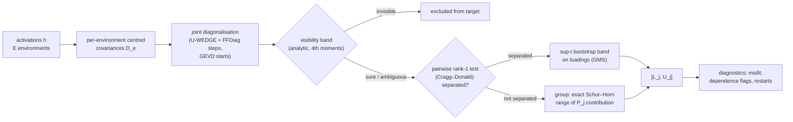

<div align="center">

# How many features does a neuron mix?

### Partial identification of thresholded feature multiplicity under co-occurrence and distribution shift

<p>


</p>

*Research B / statistical interpretability. Built from the research plan, the technical
specification and the core reading syllabus (18 Oct 2026).*

</div>

> [!IMPORTANT]
> **Every number in this README was produced by the code in this repository**, and each one is
> labelled *full run* or *pilot*. The illustrative numbers in the "Hypothetical Results"
> specification are not reproduced or targeted anywhere. Language-model experiments (E8/E9)
> are implemented and pass offline smoke tests on a random tiny GPT-NeoX. They have **not**
> been run on Pythia: this environment cannot reach Hugging Face, and the plan's theory gate
> comes first.

---

## Contents

1. [The question](#1-the-question)
2. [The estimand](#2-the-estimand)
3. [What is new here](#3-what-is-new-here)
4. [Method: ISMB in one picture](#4-method-ismb-in-one-picture)
5. [Results so far](#5-results-so-far)
6. [Experiments E0–E10](#6-experiments-e0e10)
7. [Quickstart](#7-quickstart)
8. [Repository map](#8-repository-map)
9. [Assumptions and honesty rules](#9-assumptions-and-honesty-rules)
10. [Reading map](#10-reading-map)
11. [Open items and how to help](#11-open-items)

---

## 1. The question

> *When does a polysemanticity measurement deserve confidence, and what observations make it
> more identifiable?* (plan p.2)

A neuron's activation histogram can have several peaks without the neuron mixing several
features. A sparse autoencoder is not ground truth. More data cannot separate features that
always co-occur. This project measures **how many latent features a neuron loads on**,
**reports when the data cannot determine that number**, and separates *"not enough samples"*
from *"not identified even with infinite samples."*

## 2. The estimand

For environment $e$, with a frozen network and only the input distribution varying:

$$h^{(e)} = A\,z^{(e)} + \varepsilon^{(e)}, \qquad
P_j(\tau) = \#\{\,k \text{ visible} : |A_{jk}| \ge \tau\,\},$$

with unit-norm columns, equivalence up to sign and permutation, and a **visibility** rule:
a factor counts only if its variance actually changes across environments. Stationary noise
cancels in centred covariances $D_e = A\,\mathrm{diag}(c_e)\,A^\top$.

$P_j$ is *thresholded structural loading multiplicity*. It is **not** a global feature count,
not a histogram mode count, and not a count of human concepts. Full definitions are in
[`docs/THEORY.md`](docs/THEORY.md) and [`src/polyid/estimand.py`](src/polyid/estimand.py).

## 3. What is new here

Covariance-difference identification (coroICA), mixture polysemanticity scores (DPMI) and
SAE recovery theory (GBA) already exist. The contribution targeted here is **honest inference
about $P_j$ when several decompositions fit**:

| | Result | Status |
|---|---|---|
| **Prop. 1** | Under second moments, a class of factors with collinear variance profiles is identified exactly up to $\{\mathrm{normalize}(A_G\Lambda^{1/2}R): R \in O(g)\}$ | proved ([THEORY §3](docs/THEORY.md#3-proposition-1--the-exact-second-moment-identified-set)), tested |
| **Lemma 2** | The **exact** min/max of a class's contribution to $P_j$ follows from the Schur–Horn theorem as closed-form majorisation checks, so no search over rotations is needed | proved (§4); exact against a 20k-angle sweep |
| **Prop. 2** | **Perfect co-occurrence cannot be detected from second moments.** A shared-switch block of any size is exactly fit by an uncorrelated model with *different* loadings, so every second-moment method can be confidently wrong | proved (§5); regression test |
| **ISMB** | A tractable bounding procedure combining the parts above: rank tests decide which factors are separated, an analytic visibility band, GMS-selected sup-t loading bands, and Schur–Horn group ranges | implemented; asymptotic argument with stated conditions (§7); **valid but not yet informative at `d = 16`** in pilots |
| **AR-grid** | A weak-identification-robust confidence set (Anderson–Rubin logic) for the certified $d=3$ problem; an empty set signals misspecification | implemented; grid-restricted |

## 4. Method: ISMB in one picture



Merging only ever widens an interval. Every step that can fail non-uniformly (near-collinear
profiles) is measured in E2/E4 rather than assumed away.

## 5. Results so far

### Key findings (read these first; all pilot-scale except E0)

1. **Non-identification is real and constructible (E0, full run).** Two loading matrices with
   identical covariances in every environment (difference 5.6 × 10⁻¹⁷) give different
   multiplicities. When the target is identified, ISMB's width shrinks to 0. When it is not,
   the width converges to the identified-set width and coverage stays at 1.0.
2. **Point estimates are confidently wrong under non-identification, and more data does not
   fix it (E4).** Joint-diagonalisation singletons are wrong 21–30 % of the time in the
   collinear cell at every `n`, and 34–41 % under weak diversity. ISMB covers the truth 96–100 %
   in those cells with ≤ 3.7 % confidently wrong.
3. **Perfect co-occurrence defeats every second-moment method (Proposition 2, E4).** ISMB's
   coverage there *falls* with `n` (0.97 → 0.83), exactly as the theory predicts. This is an
   impossibility result, not a tuning problem.
4. **ISMB is not yet informative at `d = 16` (E1).** It stays valid (coverage 1.0), but mean
   width is 4.7–14.7 in well-separated cells and ≈ 16 in near-collinear ones. FastICA, which
   uses non-Gaussianity, beats every second-moment method on point accuracy in the
   near-collinear half of the grid. Most of the identifying information in this generator is
   in higher moments (lab notebook §8). Adding cumulant conditions is the next step.
5. **Honest negative:** in the `d = 3` pilot the *naive* bootstrap also covered, because its
   replicates drift across the unidentified rotation. These pilots do **not** yet show an ISMB
   advantage over it. Where ISMB differs is that it *has* a coverage argument and reports the
   structure (which factors are merged, and why).

<!-- RESULTS:START -->
### E0: theory gate (full run, 40 replicates × 7 sample sizes × 2 cases)

**Constructive non-identification.** In a 4-neuron model where factors 0 and 1 share an
activity profile, two explanations have identical population covariances in all six
environments (max |difference| = **5.6 × 10⁻¹⁷**). Yet they give $P = (1,2,3,1)$ and
$P = (1,3,4,1)$.

| n per env | identifiable: joint-diag MAE | identifiable: ISMB width | not identified: joint-diag MAE | not identified: ISMB width | ISMB coverage (both cases) |
|---:|---:|---:|---:|---:|---:|
| 500 | 0.51 | 3.49 | 0.44 | 2.63 | 1.00 |
| 2 000 | 0.03 | 1.96 | 0.37 | 1.07 | 1.00 |
| 5 000 | 0.00 | 0.33 | 0.33 | 0.53 | 1.00 |
| 50 000 | 0.00 | 0.00 | 0.35 | **0.50 = identified-set width** | 1.00 |

When the target is identified, error and width go to zero. When it is not, the point error
stays flat and ISMB's width converges to **exactly** the identified-set width, without
narrowing onto a wrong singleton.

<p align="center">
<br>

</p>
<!-- RESULTS:END -->

## 6. Experiments E0–E10

Full designs, expected patterns, stop rules and compute estimates are in
[`docs/EXPERIMENT_PLAN.md`](docs/EXPERIMENT_PLAN.md).

| | Experiment | Plan section | Config | Status |
|---|---|---|---|---|
| E0 | Theory gate: identifiable vs indistinguishable | p.12 first action | `configs/planted/e0_theory_gate.yaml` | ✅ full run |
| E1 | 24-setting planted grid | spec doc | `configs/planted/e1_planted_grid.yaml` | pilot |
| E2 | Assumption stress (19 conditions) | p.3, p.10 | `configs/planted/e2_stress.yaml` | pilot |
| E3 | Frequency shift with fixed $A$ | p.5, p.10 | `configs/planted/e3_frequency_shift.yaml` | pilot |
| E4 | Coverage in the certified $d=3$ problem | p.8 | `configs/planted/e4_coverage_d3.yaml` | pilot (100 reps; 500 planned) |
| E5 | Trained toy superposition models | p.6 | `configs/toy/e5_toy_superposition.yaml` | pilot |
| E6 | TopK SAE comparison | p.6 | `configs/toy/e6_sae_comparison.yaml` | pilot |
| E7 | Modular-addition transformer bridge | p.6 (optional) | `configs/toy/e7_modular_transformer.yaml` | implemented; needs GPU |
| E8 | Pythia-160M / 410M estimation | p.4, p.9 | `configs/lm/e8_pythia*.yaml` | implemented; smoke-tested offline |
| E9 | Causal validation (matched-control ablation) | p.9 | `configs/lm/e9_pythia*.yaml` | implemented; smoke-tested offline |
| E10 | Adaptive environment selection | p.8 (optional) | `configs/planted/e10_adaptive_envs.yaml` | pilot |

## 7. Quickstart

```bash
python -m venv .venv && source .venv/bin/activate
pip install -e ".[all]"          # numpy/scipy/sklearn + torch + transformers + pytest
pytest -q                         # 104 tests (≈ 5 min on 4 CPU cores)

polyid list                                            # all experiments
polyid run configs/planted/e0_theory_gate.yaml         # theory gate (≈ 8 min, 4 cores)
polyid run configs/planted/e4_coverage_d3.yaml reps=100 --out results/e4_pilot
polyid run configs/planted/e1_planted_grid.yaml --dry-run reps=3   # inspect a resolved config
bash scripts/run_pilots.sh                             # every pilot in this README
```

Every run writes `manifest.json` (config hash, git commit, library versions, seeds), tidy CSVs
and figures. Overrides are dotted keys (`generator.n_per_env=2000`).

**Language models** (needs a GPU and Hugging Face access). First record the theory-gate
decision in the config (`theory_gate_passed: true`; criteria in
[`docs/PREREGISTRATION.md`](docs/PREREGISTRATION.md)), then:

```bash
polyid run configs/lm/e8_pythia160m.yaml --out results/e8_pythia160m
polyid run configs/lm/e9_pythia160m.yaml --out results/e9_pythia160m
```

Use the API directly:

```python
import numpy as np
from polyid import EstimandSpec
from polyid.generators import PlantedConfig, generate
from polyid.bounds.ismb import ISMB
from polyid.utils.seeding import SeedBank

ds = generate(PlantedConfig(collinear_groups=[[0, 1]]), SeedBank(0))      # oracle stays in ds.oracle
res = ISMB({"n_boot": 200}).fit(ds.observed, EstimandSpec(tau=0.10), np.random.default_rng(0))
print(res.lower, res.upper, res.diagnostics["groups"])
```

## 8. Repository map

```
src/polyid/
├── estimand.py          P_j(τ), normalisation, visibility, non-duplication, smooth surrogate
├── data.py              ObservedData: the ONLY object estimators ever see
├── generators/planted.py  planted generator + exact population moments + every stress switch
├── moments.py           per-environment covariances, fourth-moment / cluster-robust variances, bootstrap weights
├── jointdiag.py         U-WEDGE with FFDiag clamping, GEVD starts, multistart
├── matching.py          sign/permutation matching (evaluation) and replicate alignment
├── estimators/          baselines (moments, GMM/BIC, DPMI-style, PCA, FA, FastICA, joint diag,
│                        dictionary learning, naive bootstrap) + registry + Access records
├── bounds/
│   ├── schur_horn.py    Lemma 2: exact group ranges; span outer bound
│   ├── rank_tests.py    Cragg–Donald rank-1 tests, dependence test, visibility bands
│   ├── ismb.py          the proposed ISMB procedure (+ infinite-sample version)
│   ├── ar_grid.py       AR-type confidence set for d = 3 (grid-restricted)
│   └── sensitivity.py   multi-start sensitivity range (no coverage claim)
├── identification.py    oracle-side identified set: identified / partial / misspecified
├── metrics.py, stats.py coverage, width, confidently-wrong, Wilson, clustered SEs, McNemar, Holm
├── toy/                 superposition toy, TopK SAE, modular-addition transformer
├── lm/                  Pythia hooks (verified), corpus + splits, templates, cache, ablation
├── experiments/         E0–E10 runners
├── viz/                 figure style + identification map
└── cli.py               `polyid run|list`
configs/                 one YAML per experiment (+ smoke configs)
docs/                    THEORY · ASSUMPTIONS · EXPERIMENT_PLAN · PREREGISTRATION · READING_MAP
tests/                   104 tests incl. AST leakage scan, Schur–Horn exactness, rank-test size
results/                 manifests, summary CSVs and figures of every run reported above
```

## 9. Assumptions and honesty rules

All assumptions are numbered in [`docs/ASSUMPTIONS.md`](docs/ASSUMPTIONS.md): model M1–M9,
statistics S1–S9, evaluation E1–E8, language model L1–L7, and decisions D1–D12 where the
source documents were silent or in conflict. The rules enforced in code:

* **No leakage.** Estimators receive `ObservedData` only. `tests/test_leakage_and_seeds.py`
  parses every estimator module and fails if it imports the generator, the identification
  module or the metrics, or touches an oracle name.
* **Dev / test separation.** Seed namespaces `dev` and `test` never coincide. Score→count
  calibration maps are fitted on dev datasets only.
* **Fair comparisons.** Same rows for all methods; every result carries an `Access` record
  (environment labels? higher moments? restarts? model-selection budget?).
* **Labels mean something.** `confidence` = has a coverage argument; `identified_set` = exact
  population object; `sensitivity` = optimiser spread, **no coverage claim**.
* **Failure is a result.** A method that crashes is recorded, not dropped. "Confidently wrong"
  is a first-class metric.

## 10. Reading map

[`docs/READING_MAP.md`](docs/READING_MAP.md) maps each Research-B reading (S02, P1, S04, T1,
P2, S11–S12, S17–S27, X2–X4, X8–X9) to the module, test or experiment that applies it.

## 11. Open items

0. **Add fourth-order cumulant conditions to ISMB** (top priority after the E1 pilot). FastICA's
   accuracy where second moments fail shows the information is there. With independent
   non-Gaussian latents this would identify collinear-profile classes. Co-occurrence would
   stay unidentified (Prop. 2).
1. **Statistician review** of Proposition 1, Lemma 2, Proposition 2 and the ISMB coverage
   argument (plan p.8 and syllabus S23 both flag this).
2. **Full-scale runs:** E1 (500 reps × 24 cells), E2 (200 reps), E4 (500 reps). About a day on
   4 CPU cores.
3. **Language-model phase:** Hugging Face access and a GPU for E8/E9; extend the text banks to
   ≥ 2 000 held-out items per task with human checking (D10).
4. **Uniformity near collinearity** (Stoye regime): E2/E4 measure it; a repair is open.
5. **Overcomplete extension:** not claimed. SOBIUM (X9) is the prior art to engage first.
6. **DPMI:** replace the DPMI-style approximation with a verified reimplementation (D6).

---

<sub>Built on the research plan *Statistical Interpretability Research Plan* (Jihan Mankani,
18 Oct 2026). License: not yet chosen; add one before making the repository public.</sub>
