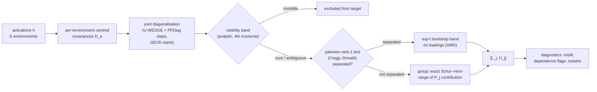
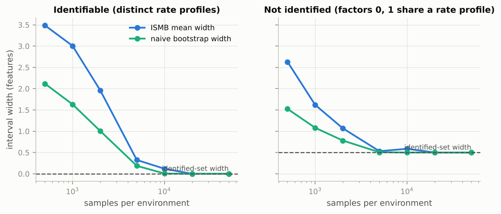
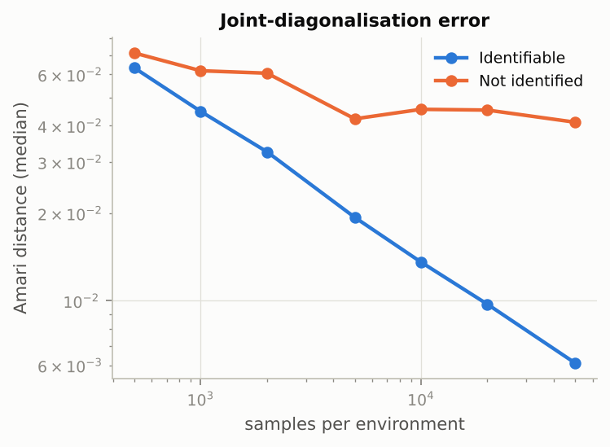
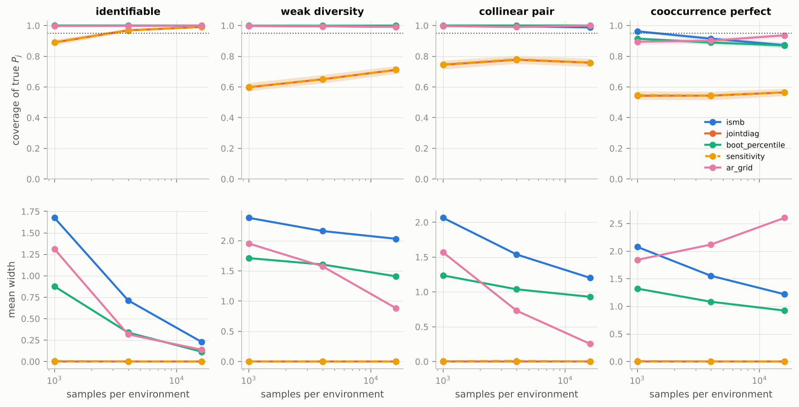
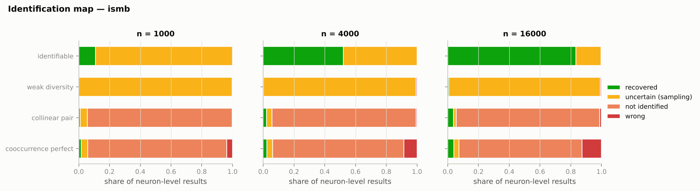
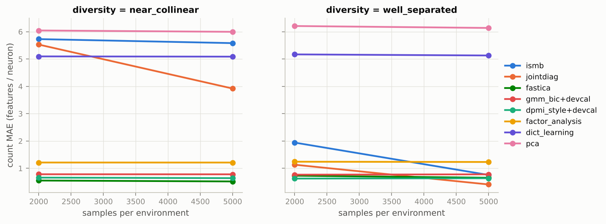
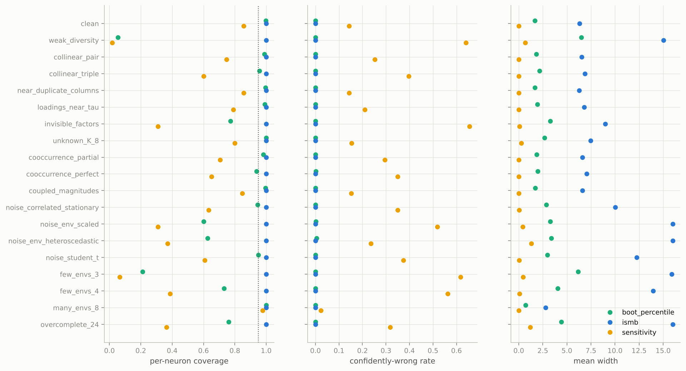
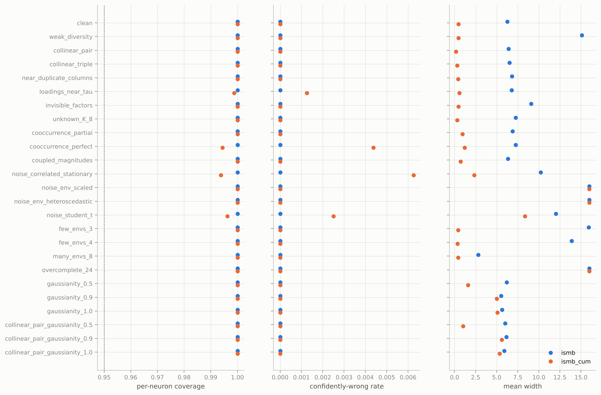
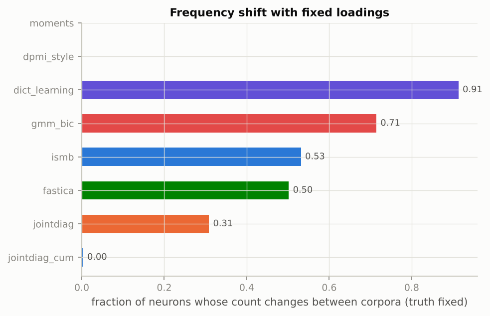

<div align="center">

# How many features does a neuron mix?

### Partial identification of thresholded feature multiplicity under co-occurrence and distribution shift

<p>


</p>

*Research B / statistical interpretability. Built from the research plan, the technical
specification and the core reading syllabus (18 Oct 2026).*

</div>

> [!IMPORTANT]
> **Every number in this README was produced by the code in this repository**, and each one is
> labelled *full run* or *pilot*. The illustrative numbers in the "Hypothetical Results"
> specification are not reproduced or targeted anywhere. Language-model experiments (E8/E9)
> are implemented and pass offline smoke tests on a random tiny GPT-NeoX. They have **not**
> been run on Pythia, because this environment cannot reach Hugging Face. The theory gate is
> open as of 2026-10-22: the proofs are labelled *numerically verified claims* until a
> statistician has reviewed them (preregistration §3 and its amendment of that date).

---

## Contents

1. [The question](#1-the-question)
2. [The estimand](#2-the-estimand)
3. [What is new here](#3-what-is-new-here)
4. [Method: ISMB in one picture](#4-method-ismb-in-one-picture)
5. [Results so far](#5-results-so-far)
6. [Experiments E0–E11](#6-experiments-e0e11)
7. [Quickstart](#7-quickstart)
8. [Repository map](#8-repository-map)
9. [Assumptions and honesty rules](#9-assumptions-and-honesty-rules)
10. [Reading map](#10-reading-map)
11. [Open items and how to help](#11-open-items)

---

## 1. The question

> *When does a polysemanticity measurement deserve confidence, and what observations make it
> more identifiable?* (plan p.2)

A neuron's activation histogram can have several peaks without the neuron mixing several
features. A sparse autoencoder is not ground truth. More data cannot separate features that
always co-occur. This project measures **how many latent features a neuron loads on**,
**reports when the data cannot determine that number**, and separates *"not enough samples"*
from *"not identified even with infinite samples."*

## 2. The estimand

For environment $e$, with a frozen network and only the input distribution varying:

$$h^{(e)} = A\,z^{(e)} + \varepsilon^{(e)}, \qquad
P_j(\tau) = \#\{\,k \text{ visible} : |A_{jk}| \ge \tau\,\},$$

with unit-norm columns, equivalence up to sign and permutation, and a **visibility** rule:
a factor counts only if its variance actually changes across environments. Stationary noise
cancels in centred covariances $D_e = A\,\mathrm{diag}(c_e)\,A^\top$.

$P_j$ is *thresholded structural loading multiplicity*. It is **not** a global feature count,
not a histogram mode count, and not a count of human concepts. Full definitions are in
[`docs/THEORY.md`](docs/THEORY.md) and [`src/polyid/estimand.py`](src/polyid/estimand.py).

## 3. What is new here

Covariance-difference identification (coroICA), mixture polysemanticity scores (DPMI) and
SAE recovery theory (GBA) already exist. The contribution targeted here is **honest inference
about $P_j$ when several decompositions fit**:

| | Result | Status |
|---|---|---|
| **Prop. 1** | Under second moments, a class of factors with collinear variance profiles is identified exactly up to $\{\mathrm{normalize}(A_G\Lambda^{1/2}R): R \in O(g)\}$. This specialises known identifiability results for second-order blind source separation (Matsuoka, Ohya & Kawamoto 1995; Pham & Cardoso 2001; Lahat, Cardoso & Messer 2012); the new part is its consequence for $P_j$ | proof written ([THEORY §3](docs/THEORY.md#3-proposition-1--the-exact-second-moment-identified-set)); numerically verified, review pending |
| **Lemma 2** | The **exact** min/max of a class's contribution to $P_j$ follows from the Schur–Horn theorem as closed-form majorisation checks, so no search over rotations is needed | proof written (§4); exact against a 20k-angle sweep; review pending |
| **Prop. 2** | **Perfect co-occurrence cannot be detected from second moments.** A shared-switch block of any size is exactly fit by an uncorrelated model with *different* loadings, so every second-moment method can be confidently wrong | proof written (§5); regression test; review pending |
| **ISMB** | A tractable bounding procedure combining the parts above: rank tests decide which factors are separated, an analytic visibility band, GMS-selected sup-t loading bands, and Schur–Horn group ranges | implemented; asymptotic argument with stated conditions (§7); **valid but not yet informative at `d = 16`** (E2 full run) |
| **AR-grid** | A weak-identification-robust confidence set (Anderson–Rubin logic) for the certified $d=3$ problem; an empty set signals misspecification | implemented; grid-restricted |

## 4. Method: ISMB in one picture



Merging only ever widens an interval. Every step that can fail non-uniformly (near-collinear
profiles) is measured in E2/E4 rather than assumed away.

## 5. Results so far

### Key findings (read these first; each is labelled full run or pilot)

1. **Non-identification is real and constructible (E0, full run).** Two loading matrices with
   identical covariances in every environment (difference 5.6 × 10⁻¹⁷) give different
   multiplicities. When the target is identified, ISMB's width shrinks to 0. When it is not, the
   width converges to the identified-set width with coverage 1.0.
2. **Point estimates are confidently wrong under non-identification, and more data does not
   fix it (E4, `d = 3`, full run: 500 replicates per cell).** Joint-diagonalisation singletons are
   wrong 22–26 % of the time in the collinear cell at every `n`, and 29–40 % under weak
   diversity. ISMB covers the truth 98.8–99.9 % in those cells with ≤ 1.1 % confidently wrong.
   That meets the E4 part of the theory gate (preregistration §3).
3. **Perfect, or exchangeable partial, co-occurrence defeats every second-moment method
   (Proposition 2 and its corollary).** In E4 (full run), ISMB coverage there *falls* with `n`
   (0.96 → 0.92 → 0.87), exactly as the theory predicts. This is an impossibility result for
   second moments, not a tuning problem. Fourth-order cumulants can detect it (finding 6).
4. **At `d = 16`, ISMB is valid where naive uncertainty collapses, but it is not informative
   (E2, full run: 200 datasets per condition).** Across 19 stress conditions ISMB covered the
   truth every time with zero confidently wrong. Its width tracks difficulty: 2.8 with 8
   environments, 6–7 in correctly specified designs, 14–16 under weak diversity, few environments
   or misspecification. The naive bootstrap's coverage fell to 0.06 (weak diversity), 0.21
   (3 environments) and 0.60–0.63 (non-stationary noise). On the 24-cell E1 grid (full run:
   500 datasets per cell, 12 000 in all) ISMB again covered every neuron in every cell with zero
   confidently wrong, at mean width 13.3 of 16 (10.8 well separated, 15.7 near collinear). The
   naive bootstrap covered 0.83 well separated but 0.17 near collinear (0.02 in the worst cell),
   and the sensitivity range was confidently wrong on 38 % and 75 % of neurons respectively.
5. **Repair: fourth-order cumulant slices (point estimates).** Adding them to the
   joint-diagonalisation stack (`jointdiag_cum`) gives count MAE ≤ 0.05 in 13 of 19 E2 conditions
   (full run). It is the most stable estimator under frequency shift: 0.3 % of neurons change
   vs 31 % for second moments (E3, full run). On the 24-cell grid it gave MAE 0.030 (97 % exact)
   against 0.61 for FastICA and 2.75 for second-moment joint diagonalisation (E1, full run). It
   degrades where its assumptions fail: co-occurrence, non-stationary or
   heavy-tailed noise, overcompleteness. Established prior art: JADE; Hyvärinen 2001;
   Tichavský et al.
6. **Cumulant-aware ISMB (`ismb_cum`, E11, full run: 100 datasets × 25 conditions;
   exploratory).** The interval version of finding 5 (THEORY §8), run on the same datasets as
   ISMB. Per-neuron coverage was at least 0.994 in every condition, and all 16 neurons of a
   dataset were covered at once in at least 95 % of datasets in every condition, the nominal
   level. With non-Gaussian latents and a correctly specified model, widths fell from ISMB's
   2.8–16 to 0.2–2.3: weak diversity 15.1 → 0.45, 3 environments 15.9 → 0.44, perfect
   co-occurrence 7.2 → 1.2 (its cross-cumulant test detects the dependence), correlated
   stationary noise 10.2 → 2.3. With near-Gaussian latents (`g ≥ 0.9`) it falls back to about
   ISMB's width (5.0–5.6 vs 5.5–6.2) and stays valid, while the cumulant point estimate fails
   there (MAE 5.7–6.1). Under misspecified noise and overcompleteness it abstains to `[0, 16]`
   as ISMB does. Confidently wrong intervals are rare but not absent: 0.6 % of neurons under
   correlated stationary noise (the case flagged in the pilot), 0.4 % under perfect
   co-occurrence, 0.2 % with Student-t noise, 0.1 % with loadings near `τ`, 0 elsewhere.
7. **Misfit gate (E2, full run).** It abstains to `[0, 16]` on 100 % of overcomplete and
   non-stationary-noise datasets and on 0–1.3 % of correctly specified ones. Under allowed but
   awkward noise it abstains needlessly but safely: 8 % with correlated stationary noise, 41 %
   with Student-t noise.
8. **Open failure: learned overcomplete geometry (E5, full run: 5 seeds, 10k steps).** Every
   trained toy model represents more features than dimensions (15–32 in `d` = 8 or 16). The gate
   fires on 40–60 % of models at `d = 8, p ≤ 0.1` but misses the rest, where ISMB undercovers
   (0.33–0.65 at `d = 8`; 0.80–0.95 at `d = 16`). This matters most for real language models.
9. **SAE counts are not multiplicity (E6, full run).** TopK-SAE decoder counts over-count by
   5–28 features per neuron, worse with larger dictionaries, even at 0.96 FVE. Reconstruction
   quality and count error correlate at −0.53.
10. **Adaptive environment choice helps (E10, full run: 100 replicates).** Width −0.55
    [−0.81, −0.29] vs random and −0.42 [−0.67, −0.17] vs balanced selection, at full coverage.

<!-- RESULTS:START -->
### E0 — theory gate *(full run: 40 replicates × 7 sample sizes × 2 cases)*

**Constructive non-identification.** Two explanations of the same 4-neuron model have
identical population covariances in all six environments (max |difference| =
**5.6e-17**) but multiplicities
`(1, 2, 3, 1)` vs `(1, 3, 4, 1)`.

| n / env | identifiable: joint-diag MAE | identifiable: ISMB width | not identified: joint-diag MAE | not identified: ISMB width | ISMB coverage (min of cases) |
|---|---|---|---|---|---|
| 500 | 0.51 | 3.49 | 0.44 | 2.63 | 1.00 |
| 1000 | 0.24 | 3.01 | 0.41 | 1.62 | 1.00 |
| 2000 | 0.03 | 1.96 | 0.37 | 1.07 | 1.00 |
| 5000 | 0.00 | 0.33 | 0.33 | 0.53 | 1.00 |
| 10000 | 0.00 | 0.12 | 0.34 | 0.59 | 1.00 |
| 20000 | 0.00 | 0.00 | 0.39 | 0.50 | 1.00 |
| 50000 | 0.00 | 0.00 | 0.35 | 0.50 | 1.00 |

Identified target → error and width go to 0. Not identified → the point error stays flat and the
ISMB width converges to the identified-set width (**0.50**) instead of collapsing onto a
wrong singleton.

<p align="center"><br>
</p>

### E4 — coverage in the certified d = 3 problem *(full run: 500 replicates per cell)*

| condition | method | coverage of true P_j (n=16000) [95% CI] | covers identified set | mean width | confidently wrong |
|---|---|---|---|---|---|
| collinear_pair | jointdiag | 0.76 [0.73, 0.78] | 0.05 | 0.00 | 0.24 |
| collinear_pair | sensitivity | 0.76 [0.73, 0.79] | 0.06 | 0.00 | 0.24 |
| collinear_pair | boot_percentile | 1.00 [1.00, 1.00] | 0.93 | 0.93 | 0.00 |
| collinear_pair | ismb | 0.99 [0.98, 1.00] | 0.98 | 1.20 | 0.01 |
| collinear_pair | ar_grid | 1.00 [1.00, 1.00] | 0.22 | 0.25 | 0.00 |
| cooccurrence_perfect | jointdiag | 0.56 [0.54, 0.59] | 0.06 | 0.00 | 0.44 |
| cooccurrence_perfect | sensitivity | 0.56 [0.54, 0.59] | 0.06 | 0.00 | 0.44 |
| cooccurrence_perfect | boot_percentile | 0.87 [0.86, 0.89] | 0.09 | 0.92 | 0.02 |
| cooccurrence_perfect | ismb | 0.87 [0.85, 0.89] | 0.29 | 1.22 | 0.05 |
| cooccurrence_perfect | ar_grid | 0.94 [0.92, 0.95] | 0.86 | 2.60 | 0.06 |
| identifiable | jointdiag | 0.99 [0.98, 1.00] | 0.99 | 0.00 | 0.01 |
| identifiable | sensitivity | 0.99 [0.98, 1.00] | 0.99 | 0.00 | 0.01 |
| identifiable | boot_percentile | 1.00 [1.00, 1.00] | 1.00 | 0.11 | 0.00 |
| identifiable | ismb | 1.00 [0.99, 1.00] | 1.00 | 0.23 | 0.00 |
| identifiable | ar_grid | 1.00 [1.00, 1.00] | 1.00 | 0.14 | 0.00 |
| weak_diversity | jointdiag | 0.71 [0.69, 0.74] | 0.71 | 0.00 | 0.29 |
| weak_diversity | sensitivity | 0.71 [0.69, 0.74] | 0.71 | 0.00 | 0.29 |
| weak_diversity | boot_percentile | 1.00 [1.00, 1.00] | 1.00 | 1.41 | 0.00 |
| weak_diversity | ismb | 0.99 [0.99, 1.00] | 0.99 | 2.03 | 0.00 |
| weak_diversity | ar_grid | 0.99 [0.99, 1.00] | 0.99 | 0.88 | 0.01 |

AR-grid empty-set rate by condition: collinear_pair: 0.02, cooccurrence_perfect: 0.57, identifiable: 0.03, weak_diversity: 0.01. Full tables (all `n`) are in
`results/e4_full/e4_summary.csv`.

<p align="center"></p>
<p align="center"></p>

### E1 — 24-setting planted grid *(full run: 500 test datasets per cell)*

Equal weight over the 24 cells (`d = K = 16`, `E = 6`, `τ = 0.10`). Score-only methods enter the
count columns only through development-split calibration (`+devcal`).

| method | mae | bias | exact | coverage | covers_idset | width_mean | confidently_wrong | spearman | auroc_poly | support_f1 |
|---|---|---|---|---|---|---|---|---|---|---|
| jointdiag_cum | 0.03 | 0.01 | 0.97 | – | – | – | – | – | – | 0.98 |
| fastica | 0.61 | 0.60 | 0.66 | – | – | – | – | – | – | 0.90 |
| dpmi_style+devcal | 0.64 | -0.04 | 0.46 | – | – | – | – | – | – | – |
| gmm_bic+devcal | 0.78 | 0.01 | 0.36 | – | – | – | – | – | – | – |
| moments+devcal | 0.91 | 0.03 | 0.33 | – | – | – | – | – | – | – |
| gmm_bic | 1.05 | 0.50 | 0.31 | – | – | – | – | 0.48 | 0.83 | – |
| factor_analysis | 1.22 | 0.36 | 0.27 | – | – | – | – | – | – | 0.44 |
| jointdiag | 2.75 | 2.74 | 0.33 | – | – | – | – | – | – | 0.69 |
| boot_percentile | 2.75 | 2.75 | 0.33 | 0.50 | 0.50 | 4.82 | 0.00 | – | – | 0.69 |
| sensitivity | 2.75 | 2.75 | 0.33 | 0.33 | 0.33 | 0.18 | 0.56 | – | – | – |
| ismb | 3.50 | 3.50 | 0.21 | 1.00 | 1.00 | 13.26 | 0.00 | – | – | 0.69 |
| dict_learning | 5.12 | 5.11 | 0.05 | – | – | – | – | – | – | 0.47 |
| pca | 6.10 | 6.09 | 0.03 | – | – | – | – | – | – | 0.38 |
| dpmi_style | – | – | – | – | – | – | – | 0.61 | 0.90 | – |
| moments | – | – | – | – | – | – | – | -0.44 | 0.26 | – |

<p align="center"></p>

### Repair — adding fourth-order cumulant slices *(pilots, point estimates; exploratory)*

Same 12 E1 cells at `n = 5000` (6 datasets each), equal-weight average:

| method | mae | bias | exact | support_f1 |
|---|---|---|---|---|
| jointdiag_cum | 0.016 | 0.001 | 0.984 | 0.990 |
| fastica | 0.605 | 0.605 | 0.655 | 0.897 |
| jointdiag | 2.217 | 2.217 | 0.396 | 0.735 |

Under the E2 stress conditions (10 datasets each), count MAE:

| condition | jointdiag | fastica | jointdiag_cum |
|---|---|---|---|
| clean | 0.13 | 0.09 | 0.00 |
| collinear_pair | 0.35 | 0.04 | 0.00 |
| collinear_triple | 0.60 | 0.04 | 0.00 |
| cooccurrence_partial | 0.27 | 0.09 | 0.10 |
| cooccurrence_perfect | 0.43 | 0.34 | 0.25 |
| coupled_magnitudes | 0.26 | 0.04 | 0.00 |
| few_envs_3 | 3.17 | 0.01 | 0.00 |
| few_envs_4 | 1.38 | 0.07 | 0.00 |
| invisible_factors | 0.95 | 0.31 | 0.05 |
| loadings_near_tau | 0.23 | 0.04 | 0.06 |
| many_envs_8 | 0.05 | 0.00 | 0.00 |
| near_duplicate_columns | 0.10 | 0.03 | 0.00 |
| noise_correlated_stationary | 0.41 | 0.23 | 0.01 |
| noise_env_heteroscedastic | 1.78 | 0.24 | 0.26 |
| noise_env_scaled | 1.01 | 0.24 | 0.13 |
| noise_student_t | 0.61 | 0.37 | 0.20 |
| overcomplete_24 | 1.68 | 0.86 | 0.73 |
| unknown_K_8 | 0.57 | 5.31 | 0.00 |
| weak_diversity | 6.61 | 0.01 | 0.00 |

### E2 — assumption stress *(full run: 200 datasets per condition)*

| condition | jointdiag MAE | coverage:ismb | coverage:boot_percentile | confidently_wrong:ismb | confidently_wrong:boot_percentile | width_mean:ismb |
|---|---|---|---|---|---|---|
| clean | 0.16 | 1.00 | 1.00 | 0.00 | 0.00 | 6.32 |
| collinear_pair | 0.30 | 1.00 | 0.99 | 0.00 | 0.00 | 6.53 |
| collinear_triple | 0.57 | 1.00 | 0.96 | 0.00 | 0.00 | 6.89 |
| cooccurrence_partial | 0.34 | 1.00 | 0.98 | 0.00 | 0.00 | 6.60 |
| cooccurrence_perfect | 0.41 | 1.00 | 0.94 | 0.00 | 0.00 | 7.07 |
| coupled_magnitudes | 0.18 | 1.00 | 1.00 | 0.00 | 0.00 | 6.61 |
| few_envs_3 | 3.55 | 1.00 | 0.21 | 0.00 | 0.00 | 15.90 |
| few_envs_4 | 1.15 | 1.00 | 0.73 | 0.00 | 0.00 | 13.97 |
| invisible_factors | 1.09 | 1.00 | 0.77 | 0.00 | 0.00 | 8.97 |
| loadings_near_tau | 0.24 | 1.00 | 0.99 | 0.00 | 0.00 | 6.81 |
| many_envs_8 | 0.02 | 1.00 | 1.00 | 0.00 | 0.00 | 2.78 |
| near_duplicate_columns | 0.16 | 1.00 | 1.00 | 0.00 | 0.00 | 6.28 |
| noise_correlated_stationary | 0.56 | 1.00 | 0.95 | 0.00 | 0.00 | 10.03 |
| noise_env_heteroscedastic | 1.50 | 1.00 | 0.63 | 0.00 | 0.01 | 16.00 |
| noise_env_scaled | 1.47 | 1.00 | 0.60 | 0.00 | 0.00 | 16.00 |
| noise_student_t | 0.61 | 1.00 | 0.95 | 0.00 | 0.00 | 12.26 |
| overcomplete_24 | 1.71 | 1.00 | 0.76 | 0.00 | 0.00 | 16.00 |
| unknown_K_8 | 0.37 | 1.00 | 1.00 | 0.00 | 0.00 | 7.45 |
| weak_diversity | 6.82 | 1.00 | 0.06 | 0.00 | 0.00 | 15.04 |

<p align="center"></p>

### E11 — cumulant-aware ISMB (`ismb_cum`) vs ISMB *(full run: 100 datasets per condition; exploratory, higher-moment information set)*

Same datasets for both methods. The 19 E2 stress conditions plus near-Gaussian latents
(`gaussianity_g`: a share `g` of each latent's variance replaced by a Gaussian, which leaves the truth
unchanged and weakens fourth-order information).

| condition | ismb:coverage | ismb_cum:coverage | ismb_cum:all_covered | ismb_cum:confidently_wrong | ismb:width_mean | ismb_cum:width_mean |
|---|---|---|---|---|---|---|
| clean | 1.000 | 1.000 | 1.000 | 0.000 | 6.246 | 0.467 |
| collinear_pair | 1.000 | 1.000 | 1.000 | 0.000 | 6.401 | 0.184 |
| collinear_pair_gaussianity_0.5 | 1.000 | 1.000 | 1.000 | 0.000 | 6.013 | 0.998 |
| collinear_pair_gaussianity_0.9 | 1.000 | 1.000 | 1.000 | 0.000 | 6.162 | 5.612 |
| collinear_pair_gaussianity_1.0 | 1.000 | 1.000 | 1.000 | 0.000 | 5.879 | 5.341 |
| collinear_triple | 1.000 | 1.000 | 1.000 | 0.000 | 6.532 | 0.309 |
| cooccurrence_partial | 1.000 | 1.000 | 1.000 | 0.000 | 6.893 | 0.927 |
| cooccurrence_perfect | 1.000 | 0.994 | 0.950 | 0.004 | 7.242 | 1.211 |
| coupled_magnitudes | 1.000 | 1.000 | 1.000 | 0.000 | 6.317 | 0.701 |
| few_envs_3 | 1.000 | 1.000 | 1.000 | 0.000 | 15.909 | 0.440 |
| few_envs_4 | 1.000 | 1.000 | 1.000 | 0.000 | 13.899 | 0.368 |
| gaussianity_0.5 | 1.000 | 1.000 | 1.000 | 0.000 | 6.199 | 1.591 |
| gaussianity_0.9 | 1.000 | 1.000 | 1.000 | 0.000 | 5.541 | 5.000 |
| gaussianity_1.0 | 1.000 | 1.000 | 1.000 | 0.000 | 5.621 | 5.072 |
| invisible_factors | 1.000 | 1.000 | 1.000 | 0.000 | 9.096 | 0.456 |
| loadings_near_tau | 1.000 | 0.999 | 0.980 | 0.001 | 6.766 | 0.555 |
| many_envs_8 | 1.000 | 1.000 | 1.000 | 0.000 | 2.824 | 0.438 |
| near_duplicate_columns | 1.000 | 1.000 | 1.000 | 0.000 | 6.813 | 0.439 |
| noise_correlated_stationary | 1.000 | 0.994 | 0.960 | 0.006 | 10.222 | 2.318 |
| noise_env_heteroscedastic | 1.000 | 1.000 | 1.000 | 0.000 | 16.000 | 16.000 |
| noise_env_scaled | 1.000 | 1.000 | 1.000 | 0.000 | 16.000 | 16.000 |
| noise_student_t | 1.000 | 0.996 | 0.960 | 0.003 | 12.024 | 8.366 |
| overcomplete_24 | 1.000 | 1.000 | 1.000 | 0.000 | 16.000 | 16.000 |
| unknown_K_8 | 1.000 | 1.000 | 1.000 | 0.000 | 7.255 | 0.330 |
| weak_diversity | 1.000 | 1.000 | 1.000 | 0.000 | 15.104 | 0.453 |

<p align="center"></p>

### E3 — frequency shift with fixed loadings *(full run: 100 replicates)*

Same `A`, three corpora with activity rates centred at 0.05 / 0.15 / 0.30; the truth is
identical across corpora by construction.

| method | frac_neurons_changed | cross_corpus_spearman | mae | coverage |
|---|---|---|---|---|
| jointdiag_cum | 0.00 | 1.00 | 0.00 | – |
| jointdiag | 0.31 | 0.89 | 0.25 | – |
| fastica | 0.50 | 0.88 | 0.47 | – |
| ismb | 0.53 | 0.82 | 0.53 | 1.00 |
| gmm_bic | 0.71 | 0.25 | 1.38 | – |
| dict_learning | 0.91 | 0.55 | 4.99 | – |
| dpmi_style | – | 0.59 | – | – |
| moments | – | 0.17 | – | – |

<p align="center"></p>

### E10 — adaptive environment selection *(full run: 100 replicates; inference on fresh data)*

| strategy | width | coverage | all_covered | n_groups |
|---|---|---|---|---|
| adaptive | 2.79 | 1.00 | 1.00 | 0.74 |
| balanced | 3.21 | 1.00 | 1.00 | 0.54 |
| random | 3.34 | 1.00 | 1.00 | 0.86 |

Paired width differences (95 % CI, replicate-level): adaptive − random: **-0.55** [-0.81, -0.29]; adaptive − balanced: **-0.42** [-0.67, -0.17].

### E5 — trained toy superposition models *(full run: 5 seeds, 10000 steps)*

Represented features per regime (truth from the learned `W`; every model is overcomplete,
which is outside the square model, so the honest outcome is abstention):

| d | feature_prob | n_represented | n_target | overcomplete | ISMB gate fired |
|---|---|---|---|---|---|
| 8 | 0.03 | 24.40 | 22.80 | 1.00 | 0.40 |
| 8 | 0.10 | 17.40 | 17.40 | 1.00 | 0.60 |
| 8 | 0.30 | 15.20 | 15.20 | 1.00 | 0.00 |
| 16 | 0.03 | 32.00 | 28.60 | 1.00 | 0.00 |
| 16 | 0.10 | 29.60 | 29.40 | 1.00 | 0.20 |
| 16 | 0.30 | 23.00 | 23.00 | 1.00 | 0.00 |

| d | feature_prob | method | mae | coverage | width_mean |
|---|---|---|---|---|---|
| 8 | 0.03 | fastica | 6.97 | – | – |
| 8 | 0.03 | gmm_bic | 7.80 | – | – |
| 8 | 0.03 | ismb | 6.95 | 0.42 | 17.32 |
| 8 | 0.03 | jointdiag | 7.10 | – | – |
| 8 | 0.03 | topk_sae | 2.33 | – | – |
| 8 | 0.10 | fastica | 4.88 | – | – |
| 8 | 0.10 | gmm_bic | 6.03 | – | – |
| 8 | 0.10 | ismb | 4.58 | 0.65 | 20.95 |
| 8 | 0.10 | jointdiag | 4.83 | – | – |
| 8 | 0.10 | topk_sae | 3.95 | – | – |
| 8 | 0.30 | fastica | 3.52 | – | – |
| 8 | 0.30 | gmm_bic | 7.38 | – | – |
| 8 | 0.30 | ismb | 3.30 | 0.33 | 4.03 |
| 8 | 0.30 | jointdiag | 3.67 | – | – |
| 8 | 0.30 | topk_sae | 5.30 | – | – |
| 16 | 0.03 | fastica | 3.15 | – | – |
| 16 | 0.03 | gmm_bic | 4.83 | – | – |
| 16 | 0.03 | ismb | 3.26 | 0.80 | 8.45 |
| 16 | 0.03 | jointdiag | 3.40 | – | – |
| 16 | 0.03 | topk_sae | 4.62 | – | – |
| 16 | 0.10 | fastica | 3.34 | – | – |
| 16 | 0.10 | gmm_bic | 4.53 | – | – |
| 16 | 0.10 | ismb | 2.23 | 0.95 | 14.50 |
| 16 | 0.10 | jointdiag | 3.33 | – | – |
| 16 | 0.10 | topk_sae | 3.88 | – | – |
| 16 | 0.30 | fastica | 1.81 | – | – |
| 16 | 0.30 | gmm_bic | 5.81 | – | – |
| 16 | 0.30 | ismb | 1.86 | 0.93 | 6.72 |
| 16 | 0.30 | jointdiag | 2.00 | – | – |
| 16 | 0.30 | topk_sae | 4.59 | – | – |

### E6 — TopK SAE baseline on planted data *(full run: 20 datasets, 6000 steps)*

| dict_mult | k | val_fve | dead_frac | mmcs_across_seeds | count_mae | count_bias |
|---|---|---|---|---|---|---|
| 2 | 1 | 0.65 | 0.01 | 0.90 | 14.77 | 14.76 |
| 2 | 2 | 0.81 | 0.03 | 0.89 | 7.17 | 7.17 |
| 2 | 4 | 0.96 | 0.20 | 0.89 | 5.06 | 5.06 |
| 4 | 1 | 0.72 | 0.04 | 0.94 | 27.95 | 27.95 |
| 4 | 2 | 0.83 | 0.03 | 0.90 | 17.59 | 17.59 |
| 4 | 4 | 0.96 | 0.35 | 0.85 | 13.39 | 13.39 |

Correlation between reconstruction quality (FVE) and count error: **-0.53**. Good
reconstruction does not certify multiplicity (plan p.10).

<!-- RESULTS:END -->

## 6. Experiments E0–E11

Full designs, expected patterns, stop rules and compute estimates are in
[`docs/EXPERIMENT_PLAN.md`](docs/EXPERIMENT_PLAN.md).

| | Experiment | Plan section | Config | Status |
|---|---|---|---|---|
| E0 | Theory gate: identifiable vs indistinguishable | p.12 first action | `configs/planted/e0_theory_gate.yaml` | ✅ full run |
| E1 | 24-setting planted grid | spec doc | `configs/planted/e1_planted_grid.yaml` | ✅ full run |
| E2 | Assumption stress (19 conditions) | p.3, p.10 | `configs/planted/e2_stress.yaml` | ✅ full run (200 reps) |
| E3 | Frequency shift with fixed $A$ | p.5, p.10 | `configs/planted/e3_frequency_shift.yaml` | ✅ full run (100 reps) |
| E4 | Coverage in the certified $d=3$ problem | p.8 | `configs/planted/e4_coverage_d3.yaml` | ✅ full run (500 reps) |
| E5 | Trained toy superposition models | p.6 | `configs/toy/e5_toy_superposition.yaml` | ✅ full run (5 seeds) |
| E6 | TopK SAE comparison | p.6 | `configs/toy/e6_sae_comparison.yaml` | ✅ full run (20 reps) |
| E7 | Modular-addition transformer bridge | p.6 (optional) | `configs/toy/e7_modular_transformer.yaml` | implemented; needs GPU |
| E8 | Pythia-160M / 410M estimation | p.4, p.9 | `configs/lm/e8_pythia*.yaml` | implemented; smoke-tested offline |
| E9 | Causal validation (matched-control ablation) | p.9 | `configs/lm/e9_pythia*.yaml` | implemented; smoke-tested offline |
| E10 | Adaptive environment selection | p.8 (optional) | `configs/planted/e10_adaptive_envs.yaml` | ✅ full run (100 reps) |
| E11 | Cumulant-aware ISMB vs ISMB (25 conditions) | README open item 0 | `configs/planted/e11_cumulant_ismb.yaml` | ✅ full run |

## 7. Quickstart

```bash
python -m venv .venv && source .venv/bin/activate
pip install -e ".[all]"          # numpy/scipy/sklearn + torch + transformers + pytest
pytest -q                         # 107 tests (≈ 6 min on 4 CPU cores)

polyid list                                            # all experiments
polyid run configs/planted/e0_theory_gate.yaml         # theory gate (≈ 8 min, 4 cores)
polyid run configs/planted/e4_coverage_d3.yaml reps=100 --out results/e4_pilot
polyid run configs/planted/e1_planted_grid.yaml --dry-run reps=3   # inspect a resolved config
bash scripts/run_pilots.sh                             # every pilot in this README
```

Every run writes `manifest.json` (config hash, git commit, library versions, seeds), tidy CSVs
and figures. Overrides are dotted keys (`generator.n_per_env=2000`).

**Language models** (needs a GPU and Hugging Face access). The theory-gate decision is recorded
in the configs (`theory_gate_passed: true`; criteria and the 2026-10-22 amendment in
[`docs/PREREGISTRATION.md`](docs/PREREGISTRATION.md)):

```bash
polyid run configs/lm/e8_pythia160m.yaml --out results/e8_pythia160m
polyid run configs/lm/e9_pythia160m.yaml --out results/e9_pythia160m
```

Use the API directly:

```python
import numpy as np
from polyid import EstimandSpec
from polyid.generators import PlantedConfig, generate
from polyid.bounds.ismb import ISMB
from polyid.utils.seeding import SeedBank

ds = generate(PlantedConfig(collinear_groups=[[0, 1]]), SeedBank(0))      # oracle stays in ds.oracle
res = ISMB({"n_boot": 200}).fit(ds.observed, EstimandSpec(tau=0.10), np.random.default_rng(0))
print(res.lower, res.upper, res.diagnostics["groups"])
```

## 8. Repository map

```
src/polyid/
├── estimand.py          P_j(τ), normalisation, visibility, non-duplication, smooth surrogate
├── data.py              ObservedData: the ONLY object estimators ever see
├── generators/planted.py  planted generator + exact population moments + every stress switch
├── moments.py           per-environment covariances, fourth-moment / cluster-robust variances, bootstrap weights
├── jointdiag.py         U-WEDGE with FFDiag clamping, GEVD starts, multistart
├── matching.py          sign/permutation matching (evaluation) and replicate alignment
├── estimators/          baselines (moments, GMM/BIC, DPMI-style, PCA, FA, FastICA, joint diag,
│                        dictionary learning, naive bootstrap) + registry + Access records;
│                        cumulant.py = exploratory 2nd+4th-order repair (jointdiag_cum)
├── bounds/
│   ├── schur_horn.py    Lemma 2: exact group ranges; span outer bound
│   ├── rank_tests.py    Cragg–Donald rank-1 tests, dependence test, visibility bands
│   ├── ismb.py          the proposed ISMB procedure (+ infinite-sample version)
│   ├── ar_grid.py       AR-type confidence set for d = 3 (grid-restricted)
│   └── sensitivity.py   multi-start sensitivity range (no coverage claim)
├── identification.py    oracle-side identified set: identified / partial / misspecified
├── metrics.py, stats.py coverage, width, confidently-wrong, Wilson, clustered SEs, McNemar, Holm
├── toy/                 superposition toy, TopK SAE, modular-addition transformer
├── lm/                  Pythia hooks (verified), corpus + splits, templates, cache, ablation
├── experiments/         E0–E10 runners
├── viz/                 figure style + identification map
└── cli.py               `polyid run|list`
configs/                 one YAML per experiment (+ smoke configs)
docs/                    THEORY · ASSUMPTIONS · EXPERIMENT_PLAN · PREREGISTRATION · READING_MAP
tests/                   107 tests incl. AST leakage scan, Schur–Horn exactness, rank-test size
results/                 manifests, summary CSVs and figures of every run reported above
```

## 9. Assumptions and honesty rules

All assumptions are numbered in [`docs/ASSUMPTIONS.md`](docs/ASSUMPTIONS.md): model M1–M9,
statistics S1–S9, evaluation E1–E8, language model L1–L7, and decisions D1–D12 where the
source documents were silent or in conflict. The rules enforced in code:

* **No leakage.** Estimators receive `ObservedData` only. `tests/test_leakage_and_seeds.py`
  parses every estimator module and fails if it imports the generator, the identification
  module or the metrics, or touches an oracle name.
* **Dev / test separation.** Seed namespaces `dev` and `test` never coincide. Score→count
  calibration maps are fitted on dev datasets only.
* **Fair comparisons.** Same rows for all methods; every result carries an `Access` record
  (environment labels? higher moments? restarts? model-selection budget?).
* **Labels mean something.** `confidence` = has a coverage argument; `identified_set` = exact
  population object; `sensitivity` = optimiser spread, **no coverage claim**.
* **Failure is a result.** A method that crashes is recorded, not dropped. "Confidently wrong"
  is a first-class metric.

## 10. Reading map

[`docs/READING_MAP.md`](docs/READING_MAP.md) maps each Research-B reading (S02, P1, S04, T1,
P2, S11–S12, S17–S27, X2–X4, X8–X9) to the module, test or experiment that applies it.

## 11. Open items

0. **Cumulant-aware ISMB.** Implemented (`ismb_cum`, THEORY §8) and validated in the full E11
   run (finding 6). Open: a coverage argument for the higher-moment information set to go with
   Propositions 1–2, and the residual confidently-wrong rate (≤ 0.6 % of neurons) under
   correlated stationary noise and perfect co-occurrence (lab notebook §13, §15).
1. **Statistician review** of Proposition 1, Lemma 2, Proposition 2 and the ISMB coverage
   argument (plan p.8 and syllabus S23 both flag this; questions in
   [`docs/REVIEW_PACKET.md`](docs/REVIEW_PACKET.md)). Until it is done, these are labelled
   "numerically verified claims", which is how the gate was opened (preregistration amendment
   of 2026-10-22). A positive review restores the theorem wording.
2. **Full-scale runs:** done and pushed for every planted and toy experiment (E1–E6, E10,
   E11). Runs checkpoint every 40 datasets and resume after a restart (`scripts/run_full.sh`,
   `scripts/run_e11.sh`).
3. **Language-model phase:** Hugging Face access and a GPU for E8/E9. E9's agreement task now
   uses 4,000 BLiMP minimal pairs (`data/blimp`, CC-BY). Its semantic task still needs a
   human-validated source (D10): WiC is near chance even for very large models, so an ablation
   could not lower it. The earlier template banks were drafted by the AI coding assistant, so
   under rule L7 they are smoke-test placeholders only.
4. **Uniformity near collinearity** (Stoye regime): E2/E4 measure it; a repair is open.
5. **Overcomplete extension:** not claimed. SOBIUM (X9) is the prior art to engage first.
6. **DPMI:** replace the DPMI-style approximation with a verified reimplementation (D6).

---

<sub>Built on the research plan *Statistical Interpretability Research Plan* (Jihan Mankani,
18 Oct 2026). License: not yet chosen; add one before making the repository public.</sub>
