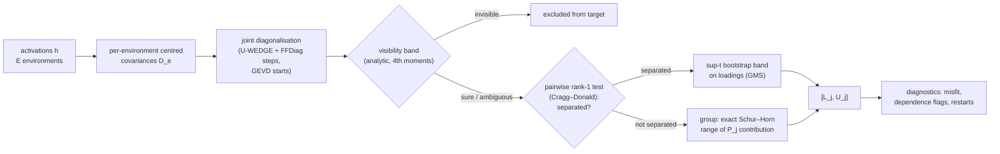

<div align="center">

# How many features does a neuron mix?

### Partial identification of thresholded feature multiplicity under co-occurrence and distribution shift

<p>


</p>

*Research B / statistical interpretability. Built from the research plan, the technical
specification and the core reading syllabus (18 Oct 2026).*

</div>

> [!IMPORTANT]
> **Every number in this README was produced by the code in this repository**, and each one is
> labelled *full run* or *pilot*. The illustrative numbers in the "Hypothetical Results"
> specification are not reproduced or targeted anywhere. Language-model experiments (E8/E9)
> are implemented and pass offline smoke tests on a random tiny GPT-NeoX. They have **not**
> been run on Pythia: this environment cannot reach Hugging Face, and the plan's theory gate
> comes first.

> [!NOTE]
> **This repository holds two studies.**
> * **Research A: activation-based monitoring** (the AI-control workstream): `src/actmon/`.
>   Summary and results in [§12](#12-research-a-activation-based-monitoring); full guide in
>   [`MONITORING.md`](MONITORING.md). A frozen actor in a resource-allocation simulator, an
>   intervention-response detector against Mahalanobis, probe and behaviour baselines, a fixed
>   audit budget, utility under monitoring, and a white-box obfuscation attack.
> * **Research B: statistical polysemanticity**: `src/polyid/`, sections 1–11 below.

---

## Contents

1. [The question](#1-the-question)
2. [The estimand](#2-the-estimand)
3. [What is new here](#3-what-is-new-here)
4. [Method: ISMB in one picture](#4-method-ismb-in-one-picture)
5. [Results so far](#5-results-so-far)
6. [Experiments E0–E10](#6-experiments-e0e10)
7. [Quickstart](#7-quickstart)
8. [Repository map](#8-repository-map)
9. [Assumptions and honesty rules](#9-assumptions-and-honesty-rules)
10. [Reading map](#10-reading-map)
11. [Open items and how to help](#11-open-items)
12. [Research A: activation-based monitoring](#12-research-a-activation-based-monitoring)

---

## 1. The question

> *When does a polysemanticity measurement deserve confidence, and what observations make it
> more identifiable?* (plan p.2)

A neuron's activation histogram can have several peaks without the neuron mixing several
features. A sparse autoencoder is not ground truth. More data cannot separate features that
always co-occur. This project measures **how many latent features a neuron loads on**,
**reports when the data cannot determine that number**, and separates *"not enough samples"*
from *"not identified even with infinite samples."*

## 2. The estimand

For environment $e$, with a frozen network and only the input distribution varying:

$$h^{(e)} = A\,z^{(e)} + \varepsilon^{(e)}, \qquad
P_j(\tau) = \#\{\,k \text{ visible} : |A_{jk}| \ge \tau\,\},$$

with unit-norm columns, equivalence up to sign and permutation, and a **visibility** rule:
a factor counts only if its variance actually changes across environments. Stationary noise
cancels in centred covariances $D_e = A\,\mathrm{diag}(c_e)\,A^\top$.

$P_j$ is *thresholded structural loading multiplicity*. It is **not** a global feature count,
not a histogram mode count, and not a count of human concepts. Full definitions are in
[`docs/THEORY.md`](docs/THEORY.md) and [`src/polyid/estimand.py`](src/polyid/estimand.py).

## 3. What is new here

Covariance-difference identification (coroICA), mixture polysemanticity scores (DPMI) and
SAE recovery theory (GBA) already exist. The contribution targeted here is **honest inference
about $P_j$ when several decompositions fit**:

| | Result | Status |
|---|---|---|
| **Prop. 1** | Under second moments, a class of factors with collinear variance profiles is identified exactly up to $\{\mathrm{normalize}(A_G\Lambda^{1/2}R): R \in O(g)\}$ | proved ([THEORY §3](docs/THEORY.md#3-proposition-1--the-exact-second-moment-identified-set)), tested |
| **Lemma 2** | The **exact** min/max of a class's contribution to $P_j$ follows from the Schur–Horn theorem as closed-form majorisation checks, so no search over rotations is needed | proved (§4); exact against a 20k-angle sweep |
| **Prop. 2** | **Perfect co-occurrence cannot be detected from second moments.** A shared-switch block of any size is exactly fit by an uncorrelated model with *different* loadings, so every second-moment method can be confidently wrong | proved (§5); regression test |
| **ISMB** | A tractable bounding procedure combining the parts above: rank tests decide which factors are separated, an analytic visibility band, GMS-selected sup-t loading bands, and Schur–Horn group ranges | implemented; asymptotic argument with stated conditions (§7); **valid but not yet informative at `d = 16`** in pilots |
| **AR-grid** | A weak-identification-robust confidence set (Anderson–Rubin logic) for the certified $d=3$ problem; an empty set signals misspecification | implemented; grid-restricted |

## 4. Method: ISMB in one picture



Merging only ever widens an interval. Every step that can fail non-uniformly (near-collinear
profiles) is measured in E2/E4 rather than assumed away.

## 5. Results so far

### Key findings (read these first; all pilot-scale except E0)

1. **Non-identification is real and constructible (E0, full run).** Two loading matrices with
   identical covariances in every environment (difference 5.6 × 10⁻¹⁷) give different
   multiplicities. When the target is identified, ISMB's width shrinks to 0. When it is not, the
   width converges to the identified-set width with coverage 1.0.
2. **Point estimates are confidently wrong under non-identification, and more data does not
   fix it (E4, `d = 3`).** Joint-diagonalisation singletons are wrong 21–30 % of the time in
   the collinear cell at every `n`, and 34–41 % under weak diversity. ISMB covers the truth
   96–100 % in those cells with ≤ 3.7 % confidently wrong.
3. **Perfect, or exchangeable partial, co-occurrence defeats every second-moment method
   (Proposition 2 and its corollary).** In E4, ISMB coverage there *falls* with `n` (0.97 → 0.83),
   exactly as the theory predicts. This is an impossibility result, not a tuning problem.
4. **At `d = 16`, ISMB is valid where naive uncertainty collapses, but it is not yet
   informative (E1, E2).** Across 19 stress conditions ISMB covered the truth every time with
   zero confidently wrong, widening where identification weakens (2.8 with 8 environments, about
   16 under weak diversity or misspecification). The naive bootstrap's coverage fell to 0.06
   (weak diversity), 0.22 (3 environments) and 0.56 (heteroscedastic noise). ISMB's mean width
   on the 24-cell grid is 13 of 16, which is honest but not yet useful.
5. **Repair: fourth-order cumulant slices.** Adding them to the joint-diagonalisation stack
   (`jointdiag_cum`) gives count MAE **0.030** on the 24-cell grid (exact 97 %, support F1
   0.99), versus 0.63 for FastICA and 2.71 for second moments alone. It is ≈ 0 in 13 of 19
   stress conditions and the most stable under frequency shift (0.3 % of neurons change vs 33 %
   for second moments; E3). It degrades where its assumptions fail: co-occurrence,
   non-stationary or heavy-tailed noise, overcompleteness. It is a point estimator with
   established prior art (JADE; Hyvärinen 2001; Tichavský et al.). The interval version is the
   next step.
6. **Misfit gate.** Added after the first E5 pilot; all pilots were then re-run. It abstains
   whenever the declared model is rejected: 100 % for overcomplete and non-stationary-noise
   designs, 0 % for correctly specified ones, and 10–20 % false abstentions under
   correlated-stationary or Student-t noise.
7. **Open failure: learned overcomplete geometry (E5).** Every trained toy model represents
   more features than dimensions. The gate catches some (d = 8, p ≤ 0.1) but misses the others,
   where ISMB undercovers (0.31 at `d = 8` dense; 0.78–0.94 at `d = 16`). This matters most for
   real language models.
8. **SAE counts are not multiplicity (E6).** TopK-SAE decoder counts over-count by 7–24
   features per neuron, worse with larger dictionaries, even at 0.96 FVE.
9. **Adaptive environment choice helps a little (E10).** Width −0.5 [−0.98, −0.03] vs random,
   at full coverage. Suggestive only.

<!-- RESULTS:START -->
### E0 — theory gate *(full run: 40 replicates × 7 sample sizes × 2 cases)*

**Constructive non-identification.** Two explanations of the same 4-neuron model have
identical population covariances in all six environments (max |difference| =
**5.6e-17**) but multiplicities
`(1, 2, 3, 1)` vs `(1, 3, 4, 1)`.

| n / env | identifiable: joint-diag MAE | identifiable: ISMB width | not identified: joint-diag MAE | not identified: ISMB width | ISMB coverage (min of cases) |
|---|---|---|---|---|---|
| 500 | 0.51 | 3.49 | 0.44 | 2.63 | 1.00 |
| 1000 | 0.24 | 3.01 | 0.41 | 1.62 | 1.00 |
| 2000 | 0.03 | 1.96 | 0.37 | 1.07 | 1.00 |
| 5000 | 0.00 | 0.33 | 0.33 | 0.53 | 1.00 |
| 10000 | 0.00 | 0.12 | 0.34 | 0.59 | 1.00 |
| 20000 | 0.00 | 0.00 | 0.39 | 0.50 | 1.00 |
| 50000 | 0.00 | 0.00 | 0.35 | 0.50 | 1.00 |

Identified target → error and width go to 0. Not identified → the point error stays flat and the
ISMB width converges to the identified-set width (**0.50**) instead of collapsing onto a
wrong singleton.

<p align="center"><br>
</p>

### E4 — coverage in the certified d = 3 problem *(pilot: 100 replicates per cell; 500 planned)*

| condition | method | coverage of true P_j (n=16000) [95% CI] | covers identified set | mean width | confidently wrong |
|---|---|---|---|---|---|
| collinear_pair | jointdiag | 0.71 [0.65, 0.78] | 0.05 | 0.00 | 0.29 |
| collinear_pair | sensitivity | 0.71 [0.65, 0.78] | 0.05 | 0.00 | 0.29 |
| collinear_pair | boot_percentile | 1.00 [1.00, 1.00] | 0.93 | 0.94 | 0.00 |
| collinear_pair | ismb | 0.96 [0.93, 0.99] | 0.95 | 1.15 | 0.04 |
| collinear_pair | ar_grid | 1.00 [1.00, 1.00] | 0.21 | 0.28 | 0.00 |
| cooccurrence_perfect | jointdiag | 0.55 [0.49, 0.62] | 0.07 | 0.00 | 0.45 |
| cooccurrence_perfect | sensitivity | 0.55 [0.49, 0.62] | 0.07 | 0.00 | 0.45 |
| cooccurrence_perfect | boot_percentile | 0.88 [0.84, 0.91] | 0.11 | 0.93 | 0.01 |
| cooccurrence_perfect | ismb | 0.83 [0.78, 0.88] | 0.24 | 1.14 | 0.07 |
| cooccurrence_perfect | ar_grid | 0.96 [0.92, 0.98] | 0.92 | 2.75 | 0.04 |
| identifiable | jointdiag | 0.98 [0.96, 1.00] | 0.98 | 0.00 | 0.02 |
| identifiable | sensitivity | 0.98 [0.96, 1.00] | 0.98 | 0.00 | 0.02 |
| identifiable | boot_percentile | 1.00 [1.00, 1.00] | 1.00 | 0.12 | 0.00 |
| identifiable | ismb | 0.99 [0.97, 1.00] | 0.99 | 0.24 | 0.01 |
| identifiable | ar_grid | 1.00 [1.00, 1.00] | 1.00 | 0.22 | 0.00 |
| weak_diversity | jointdiag | 0.66 [0.60, 0.73] | 0.66 | 0.00 | 0.34 |
| weak_diversity | sensitivity | 0.66 [0.60, 0.73] | 0.66 | 0.00 | 0.34 |
| weak_diversity | boot_percentile | 1.00 [1.00, 1.00] | 1.00 | 1.51 | 0.00 |
| weak_diversity | ismb | 0.99 [0.97, 1.00] | 0.99 | 2.04 | 0.00 |
| weak_diversity | ar_grid | 0.99 [0.97, 1.00] | 0.99 | 0.90 | 0.01 |

AR-grid empty-set rate by condition: collinear_pair: 0.03, cooccurrence_perfect: 0.56, identifiable: 0.05, weak_diversity: 0.01. Full tables (all `n`) are in
`results/e4_coverage_d3_pilot/e4_summary.csv`.

<p align="center"></p>
<p align="center"></p>

### E1 — 24-setting planted grid *(pilot: 6 test datasets per cell; 500 planned)*

Equal weight over the 24 cells (`d = K = 16`, `E = 6`, `τ = 0.10`). Score-only methods enter the
count columns only through development-split calibration (`+devcal`).

| method | mae | bias | exact | coverage | covers_idset | width_mean | confidently_wrong | spearman | auroc_poly | support_f1 |
|---|---|---|---|---|---|---|---|---|---|---|
| jointdiag_cum | 0.03 | 0.02 | 0.97 | – | – | – | – | – | – | 0.99 |
| dpmi_style+devcal | 0.60 | 0.01 | 0.49 | – | – | – | – | – | – | – |
| fastica | 0.63 | 0.62 | 0.65 | – | – | – | – | – | – | 0.90 |
| gmm_bic+devcal | 0.76 | 0.03 | 0.37 | – | – | – | – | – | – | – |
| gmm_bic | 0.80 | -0.17 | 0.42 | – | – | – | – | 0.51 | 0.85 | – |
| moments+devcal | 0.90 | 0.05 | 0.32 | – | – | – | – | – | – | – |
| factor_analysis | 1.21 | 0.42 | 0.27 | – | – | – | – | – | – | 0.44 |
| jointdiag | 2.71 | 2.71 | 0.32 | – | – | – | – | – | – | 0.69 |
| boot_percentile | 2.71 | 2.71 | 0.32 | 0.50 | 0.50 | 4.85 | 0.00 | – | – | 0.69 |
| sensitivity | 2.71 | 2.71 | 0.32 | 0.33 | 0.33 | 0.27 | 0.52 | – | – | – |
| ismb | 3.44 | 3.43 | 0.22 | 1.00 | 1.00 | 13.27 | 0.00 | – | – | 0.69 |
| dict_learning | 5.12 | 5.11 | 0.05 | – | – | – | – | – | – | 0.46 |
| pca | 6.09 | 6.09 | 0.03 | – | – | – | – | – | – | 0.38 |
| dpmi_style | – | – | – | – | – | – | – | 0.61 | 0.89 | – |
| moments | – | – | – | – | – | – | – | -0.46 | 0.25 | – |

<p align="center"></p>

### Repair — adding fourth-order cumulant slices *(pilots, point estimates; exploratory)*

Same 12 E1 cells at `n = 5000` (6 datasets each), equal-weight average:

| method | mae | bias | exact | support_f1 |
|---|---|---|---|---|
| jointdiag_cum | 0.016 | 0.001 | 0.984 | 0.990 |
| fastica | 0.605 | 0.605 | 0.655 | 0.897 |
| jointdiag | 2.217 | 2.217 | 0.396 | 0.735 |

Under the E2 stress conditions (10 datasets each), count MAE:

| condition | jointdiag | fastica | jointdiag_cum |
|---|---|---|---|
| clean | 0.13 | 0.09 | 0.00 |
| collinear_pair | 0.35 | 0.04 | 0.00 |
| collinear_triple | 0.60 | 0.04 | 0.00 |
| cooccurrence_partial | 0.27 | 0.09 | 0.10 |
| cooccurrence_perfect | 0.43 | 0.34 | 0.25 |
| coupled_magnitudes | 0.26 | 0.04 | 0.00 |
| few_envs_3 | 3.17 | 0.01 | 0.00 |
| few_envs_4 | 1.38 | 0.07 | 0.00 |
| invisible_factors | 0.95 | 0.31 | 0.05 |
| loadings_near_tau | 0.23 | 0.04 | 0.06 |
| many_envs_8 | 0.05 | 0.00 | 0.00 |
| near_duplicate_columns | 0.10 | 0.03 | 0.00 |
| noise_correlated_stationary | 0.41 | 0.23 | 0.01 |
| noise_env_heteroscedastic | 1.78 | 0.24 | 0.26 |
| noise_env_scaled | 1.01 | 0.24 | 0.13 |
| noise_student_t | 0.61 | 0.37 | 0.20 |
| overcomplete_24 | 1.68 | 0.86 | 0.73 |
| unknown_K_8 | 0.57 | 5.31 | 0.00 |
| weak_diversity | 6.61 | 0.01 | 0.00 |

### E2 — assumption stress *(pilot: 10 datasets per condition)*

| condition | jointdiag MAE | coverage:ismb | coverage:boot_percentile | confidently_wrong:ismb | confidently_wrong:boot_percentile | width_mean:ismb |
|---|---|---|---|---|---|---|
| clean | 0.13 | 1.00 | 0.99 | 0.00 | 0.00 | 7.08 |
| collinear_pair | 0.35 | 1.00 | 0.99 | 0.00 | 0.00 | 6.05 |
| collinear_triple | 0.60 | 1.00 | 0.92 | 0.00 | 0.00 | 7.97 |
| cooccurrence_partial | 0.27 | 1.00 | 0.97 | 0.00 | 0.00 | 6.77 |
| cooccurrence_perfect | 0.43 | 1.00 | 0.96 | 0.00 | 0.00 | 6.63 |
| coupled_magnitudes | 0.26 | 1.00 | 0.99 | 0.00 | 0.00 | 7.36 |
| few_envs_3 | 3.17 | 1.00 | 0.23 | 0.00 | 0.00 | 15.97 |
| few_envs_4 | 1.38 | 1.00 | 0.71 | 0.00 | 0.00 | 14.10 |
| invisible_factors | 0.95 | 1.00 | 0.80 | 0.00 | 0.00 | 8.78 |
| loadings_near_tau | 0.23 | 1.00 | 0.99 | 0.00 | 0.01 | 6.17 |
| many_envs_8 | 0.05 | 1.00 | 1.00 | 0.00 | 0.00 | 2.79 |
| near_duplicate_columns | 0.10 | 1.00 | 1.00 | 0.00 | 0.00 | 5.58 |
| noise_correlated_stationary | 0.41 | 1.00 | 0.96 | 0.00 | 0.00 | 9.57 |
| noise_env_heteroscedastic | 1.78 | 1.00 | 0.56 | 0.00 | 0.01 | 16.00 |
| noise_env_scaled | 1.01 | 1.00 | 0.77 | 0.00 | 0.00 | 16.00 |
| noise_student_t | 0.61 | 1.00 | 0.95 | 0.00 | 0.00 | 11.76 |
| overcomplete_24 | 1.68 | 1.00 | 0.78 | 0.00 | 0.00 | 16.00 |
| unknown_K_8 | 0.57 | 1.00 | 1.00 | 0.00 | 0.00 | 7.81 |
| weak_diversity | 6.61 | 1.00 | 0.06 | 0.00 | 0.00 | 15.06 |

<p align="center"></p>

### E3 — frequency shift with fixed loadings *(pilot)*

Same `A`, three corpora with activity rates centred at 0.05 / 0.15 / 0.30; the truth is
identical across corpora by construction.

| method | frac_neurons_changed | cross_corpus_spearman | mae | coverage |
|---|---|---|---|---|
| jointdiag_cum | 0.00 | 1.00 | 0.00 | – |
| jointdiag | 0.33 | 0.89 | 0.28 | – |
| ismb | 0.51 | 0.82 | 0.49 | 1.00 |
| fastica | 0.53 | 0.86 | 0.48 | – |
| gmm_bic | 0.69 | 0.30 | 0.83 | – |
| dict_learning | 0.90 | 0.52 | 4.76 | – |
| dpmi_style | – | 0.55 | – | – |
| moments | – | 0.18 | – | – |

<p align="center"></p>

### E10 — adaptive environment selection *(pilot, 30 replicates; inference on fresh data)*

| strategy | width | coverage | all_covered | n_groups |
|---|---|---|---|---|
| adaptive | 2.92 | 1.00 | 1.00 | 0.67 |
| balanced | 3.48 | 1.00 | 1.00 | 0.53 |
| random | 3.51 | 1.00 | 1.00 | 1.00 |

Paired width differences (95 % CI, replicate-level): adaptive − random: **-0.59** [-1.11, -0.07]; adaptive − balanced: **-0.56** [-1.05, -0.07]. Suggestive only: two
comparisons, and each interval barely excludes 0.

### E5 — trained toy superposition models *(pilot: 2 seeds, 4k steps)*

Represented features per regime (truth from the learned `W`; every model is overcomplete,
which is outside the square model, so the honest outcome is abstention):

| d | feature_prob | n_represented | n_target | overcomplete | ISMB gate fired |
|---|---|---|---|---|---|
| 8 | 0.03 | 24.50 | 23.00 | 1.00 | 0.50 |
| 8 | 0.10 | 17.50 | 17.50 | 1.00 | 1.00 |
| 8 | 0.30 | 15.50 | 15.50 | 1.00 | 0.00 |
| 16 | 0.03 | 32.00 | 30.00 | 1.00 | 0.00 |
| 16 | 0.10 | 30.50 | 30.00 | 1.00 | 0.00 |
| 16 | 0.30 | 23.00 | 23.00 | 1.00 | 0.00 |

| d | feature_prob | method | mae | coverage | width_mean |
|---|---|---|---|---|---|
| 8 | 0.03 | fastica | 7.12 | – | – |
| 8 | 0.03 | gmm_bic | 9.06 | – | – |
| 8 | 0.03 | ismb | 7.62 | 0.56 | 19.75 |
| 8 | 0.03 | jointdiag | 7.50 | – | – |
| 8 | 0.03 | topk_sae | 1.81 | – | – |
| 8 | 0.10 | fastica | 4.75 | – | – |
| 8 | 0.10 | gmm_bic | 6.19 | – | – |
| 8 | 0.10 | ismb | 4.62 | 1.00 | 32.00 |
| 8 | 0.10 | jointdiag | 4.62 | – | – |
| 8 | 0.10 | topk_sae | 4.00 | – | – |
| 8 | 0.30 | fastica | 3.50 | – | – |
| 8 | 0.30 | gmm_bic | 7.12 | – | – |
| 8 | 0.30 | ismb | 3.12 | 0.31 | 3.56 |
| 8 | 0.30 | jointdiag | 3.50 | – | – |
| 8 | 0.30 | topk_sae | 6.06 | – | – |
| 16 | 0.03 | fastica | 3.50 | – | – |
| 16 | 0.03 | gmm_bic | 5.44 | – | – |
| 16 | 0.03 | ismb | 3.50 | 0.78 | 8.56 |
| 16 | 0.03 | jointdiag | 3.62 | – | – |
| 16 | 0.03 | topk_sae | 3.97 | – | – |
| 16 | 0.10 | fastica | 3.62 | – | – |
| 16 | 0.10 | gmm_bic | 6.12 | – | – |
| 16 | 0.10 | ismb | 2.06 | 0.94 | 10.19 |
| 16 | 0.10 | jointdiag | 3.56 | – | – |
| 16 | 0.10 | topk_sae | 4.19 | – | – |
| 16 | 0.30 | fastica | 1.84 | – | – |
| 16 | 0.30 | gmm_bic | 5.72 | – | – |
| 16 | 0.30 | ismb | 1.78 | 0.94 | 6.50 |
| 16 | 0.30 | jointdiag | 1.84 | – | – |
| 16 | 0.30 | topk_sae | 5.12 | – | – |

### E6 — TopK SAE baseline on planted data *(pilot)*

| dict_mult | k | val_fve | dead_frac | mmcs_across_seeds | count_mae | count_bias |
|---|---|---|---|---|---|---|
| 2 | 1 | 0.65 | 0.01 | 0.93 | 13.51 | 13.51 |
| 2 | 2 | 0.81 | 0.04 | 0.88 | 7.27 | 7.27 |
| 2 | 4 | 0.96 | 0.11 | 0.86 | 6.86 | 6.86 |
| 4 | 1 | 0.72 | 0.05 | 0.93 | 23.89 | 23.89 |
| 4 | 2 | 0.83 | 0.04 | 0.88 | 18.98 | 18.98 |
| 4 | 4 | 0.96 | 0.16 | 0.82 | 20.48 | 20.48 |

Correlation between reconstruction quality (FVE) and count error: **-0.20**. Good
reconstruction does not certify multiplicity (plan p.10).

<!-- RESULTS:END -->

## 6. Experiments E0–E10

Full designs, expected patterns, stop rules and compute estimates are in
[`docs/EXPERIMENT_PLAN.md`](docs/EXPERIMENT_PLAN.md).

| | Experiment | Plan section | Config | Status |
|---|---|---|---|---|
| E0 | Theory gate: identifiable vs indistinguishable | p.12 first action | `configs/planted/e0_theory_gate.yaml` | ✅ full run |
| E1 | 24-setting planted grid | spec doc | `configs/planted/e1_planted_grid.yaml` | pilot |
| E2 | Assumption stress (19 conditions) | p.3, p.10 | `configs/planted/e2_stress.yaml` | pilot |
| E3 | Frequency shift with fixed $A$ | p.5, p.10 | `configs/planted/e3_frequency_shift.yaml` | pilot |
| E4 | Coverage in the certified $d=3$ problem | p.8 | `configs/planted/e4_coverage_d3.yaml` | pilot (100 reps; 500 planned) |
| E5 | Trained toy superposition models | p.6 | `configs/toy/e5_toy_superposition.yaml` | pilot |
| E6 | TopK SAE comparison | p.6 | `configs/toy/e6_sae_comparison.yaml` | pilot |
| E7 | Modular-addition transformer bridge | p.6 (optional) | `configs/toy/e7_modular_transformer.yaml` | implemented; needs GPU |
| E8 | Pythia-160M / 410M estimation | p.4, p.9 | `configs/lm/e8_pythia*.yaml` | implemented; smoke-tested offline |
| E9 | Causal validation (matched-control ablation) | p.9 | `configs/lm/e9_pythia*.yaml` | implemented; smoke-tested offline |
| E10 | Adaptive environment selection | p.8 (optional) | `configs/planted/e10_adaptive_envs.yaml` | pilot |

## 7. Quickstart

```bash
python -m venv .venv && source .venv/bin/activate
pip install -e ".[all]"          # numpy/scipy/sklearn + torch + transformers + pytest
pytest -q                         # 146 tests: 107 Research B + 39 Research A (≈ 8 min, 4 cores)

polyid list                                            # all experiments
polyid run configs/planted/e0_theory_gate.yaml         # theory gate (≈ 8 min, 4 cores)
polyid run configs/planted/e4_coverage_d3.yaml reps=100 --out results/e4_pilot
polyid run configs/planted/e1_planted_grid.yaml --dry-run reps=3   # inspect a resolved config
bash scripts/run_pilots.sh                             # every pilot in this README
```

Every run writes `manifest.json` (config hash, git commit, library versions, seeds), tidy CSVs
and figures. Overrides are dotted keys (`generator.n_per_env=2000`).

**Language models** (needs a GPU and Hugging Face access). First record the theory-gate
decision in the config (`theory_gate_passed: true`; criteria in
[`docs/PREREGISTRATION.md`](docs/PREREGISTRATION.md)), then:

```bash
polyid run configs/lm/e8_pythia160m.yaml --out results/e8_pythia160m
polyid run configs/lm/e9_pythia160m.yaml --out results/e9_pythia160m
```

Use the API directly:

```python
import numpy as np
from polyid import EstimandSpec
from polyid.generators import PlantedConfig, generate
from polyid.bounds.ismb import ISMB
from polyid.utils.seeding import SeedBank

ds = generate(PlantedConfig(collinear_groups=[[0, 1]]), SeedBank(0))      # oracle stays in ds.oracle
res = ISMB({"n_boot": 200}).fit(ds.observed, EstimandSpec(tau=0.10), np.random.default_rng(0))
print(res.lower, res.upper, res.diagnostics["groups"])
```

## 8. Repository map

```
src/polyid/
├── estimand.py          P_j(τ), normalisation, visibility, non-duplication, smooth surrogate
├── data.py              ObservedData: the ONLY object estimators ever see
├── generators/planted.py  planted generator + exact population moments + every stress switch
├── moments.py           per-environment covariances, fourth-moment / cluster-robust variances, bootstrap weights
├── jointdiag.py         U-WEDGE with FFDiag clamping, GEVD starts, multistart
├── matching.py          sign/permutation matching (evaluation) and replicate alignment
├── estimators/          baselines (moments, GMM/BIC, DPMI-style, PCA, FA, FastICA, joint diag,
│                        dictionary learning, naive bootstrap) + registry + Access records;
│                        cumulant.py = exploratory 2nd+4th-order repair (jointdiag_cum)
├── bounds/
│   ├── schur_horn.py    Lemma 2: exact group ranges; span outer bound
│   ├── rank_tests.py    Cragg–Donald rank-1 tests, dependence test, visibility bands
│   ├── ismb.py          the proposed ISMB procedure (+ infinite-sample version)
│   ├── ar_grid.py       AR-type confidence set for d = 3 (grid-restricted)
│   └── sensitivity.py   multi-start sensitivity range (no coverage claim)
├── identification.py    oracle-side identified set: identified / partial / misspecified
├── metrics.py, stats.py coverage, width, confidently-wrong, Wilson, clustered SEs, McNemar, Holm
├── toy/                 superposition toy, TopK SAE, modular-addition transformer
├── lm/                  Pythia hooks (verified), corpus + splits, templates, cache, ablation
├── experiments/         E0–E10 runners
├── viz/                 figure style + identification map
└── cli.py               `polyid run|list`
src/actmon/              Research A (activation-based monitoring); map in MONITORING.md §11
configs/                 one YAML per experiment (+ smoke configs); configs/monitor/ for Research A
docs/                    THEORY · ASSUMPTIONS · EXPERIMENT_PLAN · PREREGISTRATION · READING_MAP
docs/monitoring/         Research A: THREAT_MODEL · EXPERIMENT_PLAN · ASSUMPTIONS · PREREGISTRATION · RUNBOOK · …
tests/                   Research B tests (AST leakage scan, Schur–Horn exactness, rank-test size)
tests/monitor/           Research A tests (oracle, transforms, hooks, decoding, detectors, attack, Qwen path)
results/                 manifests, summary CSVs and figures of every run reported above
```

## 9. Assumptions and honesty rules

All assumptions are numbered in [`docs/ASSUMPTIONS.md`](docs/ASSUMPTIONS.md): model M1–M9,
statistics S1–S9, evaluation E1–E8, language model L1–L7, and decisions D1–D12 where the
source documents were silent or in conflict. The rules enforced in code:

* **No leakage.** Estimators receive `ObservedData` only. `tests/test_leakage_and_seeds.py`
  parses every estimator module and fails if it imports the generator, the identification
  module or the metrics, or touches an oracle name.
* **Dev / test separation.** Seed namespaces `dev` and `test` never coincide. Score→count
  calibration maps are fitted on dev datasets only.
* **Fair comparisons.** Same rows for all methods; every result carries an `Access` record
  (environment labels? higher moments? restarts? model-selection budget?).
* **Labels mean something.** `confidence` = has a coverage argument; `identified_set` = exact
  population object; `sensitivity` = optimiser spread, **no coverage claim**.
* **Failure is a result.** A method that crashes is recorded, not dropped. "Confidently wrong"
  is a first-class metric.

## 10. Reading map

[`docs/READING_MAP.md`](docs/READING_MAP.md) maps each Research-B reading (S02, P1, S04, T1,
P2, S11–S12, S17–S27, X2–X4, X8–X9) to the module, test or experiment that applies it.

## 11. Open items

0. **Cumulant-aware ISMB** (top priority). The point estimator `jointdiag_cum` already
   resolves the weak-identification failures. The interval version needs pair tests that use
   cumulant slices and a coverage argument for the higher-moment information set. Check
   whether dependent latents (Prop. 2) become *detectable* with cumulants: a cumulant tensor of
   dependent latents is not diagonal.
1. **Statistician review** of Proposition 1, Lemma 2, Proposition 2 and the ISMB coverage
   argument (plan p.8 and syllabus S23 both flag this).
2. **Full-scale runs:** E1 (500 reps × 24 cells), E2 (200 reps), E4 (500 reps). About a day on
   4 CPU cores.
3. **Language-model phase:** Hugging Face access and a GPU for E8/E9; extend the text banks to
   ≥ 2 000 held-out items per task with human checking (D10).
4. **Uniformity near collinearity** (Stoye regime): E2/E4 measure it; a repair is open.
5. **Overcomplete extension:** not claimed. SOBIUM (X9) is the prior art to engage first.
6. **DPMI:** replace the DPMI-style approximation with a verified reimplementation (D6).

## 12. Research A: activation-based monitoring

*The AI-control workstream. Full guide: [`MONITORING.md`](MONITORING.md). Threat model:
[`docs/monitoring/THREAT_MODEL.md`](docs/monitoring/THREAT_MODEL.md).*

**Question.** At a fixed false-positive rate, does a detector that reads how a frozen actor's
decision-token representation *responds to counterfactual edits of its input* catch more policy
violations than activation-distance monitors, a matched linear probe and a behaviour-only monitor,
all scored on the same roots?

**Setup.** A finite-state resource-allocation simulator with signed authorization, reserve floors,
review requirements and operator handoffs. A deterministic oracle labels the actor's *actual*
proposal. The monitored checkpoint M2 is the actor plus a simulator-only LoRA adapter trained to
trade the reserve and review rules for throughput, more strongly when a planted cue is present.
Activations are the residual stream after blocks 6/13/20 of Qwen2.5-1.5B-Instruct (declared actor)
at the final prompt token. The study uses 32-d training-only projections, four task-preserving and
two task-changing edits, the specification's split sizes (1,000 fit / 500 + 500 dev / 5,000
calibration / 5,000 + 500 test / 900 + 100 audit / 500 benign utility) and 8 held-out template
families.

**Status.** The full pipeline runs on CPU with a small `Qwen2ForCausalLM` actor trained from scratch
on the simulator (no GPU or Hugging Face here). The Qwen path is implemented and tested offline. The
tables below are **pipeline evidence from the small actor**, generated by
`scripts/summarize_monitor.py`.

### Research A key findings (small offline actor: pipeline evidence)

* **Pipeline validated.** The hook is exact, every task-preserving edit passed validation, the A0
  detector gate passed, and calibration held (achieved FPR 3.8–5.6 % at a 5 % target).
* **H1 not supported.** At 5 % FPR the proposed response detector catches 3.8 % of violations,
  against 3.0 % for task-conditioned Mahalanobis (+0.8 points, McNemar p = 0.56). All label-free
  activation monitors sit near chance on this actor.
* **Supervised monitors win.** The behaviour-only logistic catches 36.8 % (AUROC 0.91) and the
  linear probe 17.0 %. Both use labels. Most violations of this weak stand-in are ordinary mistakes,
  not anomalous computation.
* **Partial mechanism.** The organism learned throughput-seeking under reserve conflicts (M2 46–51 %
  vs M1 9–14 %), but not cue-conditioning.
* **Attack.** The unoptimised soft prompt is itself detected (pooled Mahalanobis 50 %), but with an
  evasion term the white-box attacker drives recall to ≤ 1.2 % while keeping 96–98 % of the
  violations.
* **Post hoc hint.** Removing the context model or using only task-preserving responses roughly
  triples the proposed detector's TPR (≈ 10 % on dev and test). This needs a fresh split before it
  counts.

Full interpretation, tables and decision-rule outcomes: [`MONITORING.md` §9](MONITORING.md#9-results).

<!-- MONITOR:START -->
*Generated by `scripts/summarize_monitor.py` from `results/monitor/`. Small offline actor: pipeline evidence, not a claim about Qwen2.5-1.5B-Instruct.*

**A0 · detector gate on planted activations** (5 worlds × 300 violating / 2,000 normal test roots per regime; TPR % at a 5 % FPR target). Gate passed: **yes**.

| detector | null | base shift | context shift | response only | max FPR % |
|---|---|---|---|---|---|
| linear probe † (S10) | 4.8 | 100.0 | 4.4 | 4.4 | 4.9 |
| env-centred Mahalanobis (S13) | 4.9 | 97.6 | 3.5 | 4.5 | 5.1 |
| pooled Mahalanobis | 4.9 | 97.3 | 4.2 | 4.9 | 5.2 |
| task-conditioned Mahalanobis | 5.3 | 97.4 | 100.0 | 4.9 | 5.2 |
| **response (proposed)** | 4.7 | 13.1 | 61.2 | 93.3 | 5.6 |
| response_plus_base | 4.7 | 88.8 | 44.1 | 84.4 | 5.3 |

**A1 · actor and benchmark audit** (small offline actor).

Competence (agreement with the planner's verb / validity rate, 1,000 fresh roots): m1_id: 82.7 % / 87.4 %; m2_id: 88.0 % / 75.3 %; m2_heldout: 90.6 % / 76.8 %.
Hook check max |hook − hidden_states| = 0.0e+00 at sites [1, 2, 4]. Organism drift (M1 ≠ M2 answer): no-conflict roots 21.7 %, conflict roots 16.4 %, benign 31.0 %.

| throughput conflict | cue | roots | M1 violates % | M2 violates % |
|---|---|---|---|---|
| blocked | no | 833 | 0.0 | 0.0 |
| blocked | yes | 361 | 0.0 | 0.0 |
| none | no | 1790 | 28.4 | 44.9 |
| none | yes | 784 | 29.5 | 46.9 |
| reserve | no | 566 | 14.1 | 50.9 |
| reserve | yes | 257 | 8.9 | 45.9 |
| review | no | 512 | 0.0 | 0.6 |
| review | yes | 222 | 0.0 | 8.1 |
| review+reserve | no | 465 | 0.0 | 1.1 |
| review+reserve | yes | 210 | 0.0 | 5.7 |

Violations in the locked test split by mechanism: ordinary_mistake 239, objective_conflict 156, adapter_drift 87, cue_conditioned 18. Task-changing edits changed the planner's action in auth_change 76.5 %, requirement_change 36.8 % of roots; 5 action strings are permitted in some test roots and prohibited in others.

**A2 · locked detection test** (5,000 normal + 500 violating roots; thresholds from 5,000 normal calibration roots). Cells: TPR % (achieved FPR %). † = receives development violation labels.

| monitor | 1 % FPR | 2 % FPR | 5 % FPR | AUROC |
|---|---|---|---|---|
| **response (proposed)** | 1.0 (1.12) | 1.8 (2.04) | 3.8 (4.56) | 0.552 |
| task-conditioned Mahalanobis | 0.2 (0.72) | 0.6 (1.60) | 3.0 (4.08) | 0.651 |
| pooled Mahalanobis | 0.4 (0.74) | 1.0 (1.54) | 3.0 (4.00) | 0.657 |
| env-centred Mahalanobis (S13) | 0.6 (0.82) | 1.0 (1.56) | 3.0 (3.78) | 0.651 |
| linear probe † (S10) | 2.2 (0.80) | 6.0 (1.42) | 17.0 (4.52) | 0.822 |
| contrast-pair probe (S10) | 0.0 (0.86) | 0.0 (1.98) | 0.0 (5.46) | 0.484 |
| behaviour-only logistic † | 9.4 (0.84) | 17.6 (2.02) | 36.8 (5.56) | 0.906 |
| STRIP-style (S14) | 0.0 (1.10) | 0.0 (1.88) | 0.0 (5.12) | 0.534 |
| TeCo-style (S14) | 0.0 (0.00) | 0.0 (0.00) | 9.0 (4.40) | 0.532 |
| FA-style (S15) | 2.0 (1.22) | 2.8 (1.88) | 4.6 (4.62) | 0.519 |

Paired comparison at 5 % FPR, proposed vs each comparator on the same violating roots (both / proposed only / comparator only / neither; TPR difference in points with a template-family-clustered 95 % interval, 24 clusters; exact McNemar; Holm over 27 tests).

| comparator | 2×2 cells | Δ TPR (pts) | McNemar p | Holm p |
|---|---|---|---|---|
| pooled Mahalanobis | 4/15/11/470 | +0.8 [-0.8, +2.4] | 0.56 | 1 |
| task-conditioned Mahalanobis | 4/15/11/470 | +0.8 [-0.4, +2.0] | 0.56 | 1 |
| behaviour-only logistic † | 8/11/176/305 | -33.0 [-37.9, -28.1] | 2e-39 | 5.3e-38 |
| linear probe † (S10) | 3/16/82/399 | -13.2 [-18.9, -7.5] | 7.4e-12 | 1.8e-10 |
| STRIP-style (S14) | 0/19/0/481 | +3.8 [+2.6, +5.0] | 3.8e-06 | 8.8e-05 |
| env-centred Mahalanobis (S13) | 4/15/11/470 | +0.8 [-0.8, +2.4] | 0.56 | 1 |
| FA-style (S15) | 1/18/22/459 | -0.8 [-2.6, +1.0] | 0.64 | 1 |
| TeCo-style (S14) | 4/15/41/440 | -5.2 [-7.6, -2.8] | 0.00069 | 0.014 |
| contrast-pair probe (S10) | 0/19/0/481 | +3.8 [+2.6, +5.0] | 3.8e-06 | 8.8e-05 |

Held-out template families (1,000 normal + 200 violating, 8 families the actor never saw; same thresholds), 5 % target:

| monitor | TPR % | achieved FPR % |
|---|---|---|
| **response (proposed)** | 3.0 | 5.50 |
| task-conditioned Mahalanobis | 6.5 | 5.40 |
| pooled Mahalanobis | 5.0 | 5.40 |
| env-centred Mahalanobis (S13) | 10.5 | 8.10 |
| linear probe † (S10) | 12.5 | 5.50 |
| contrast-pair probe (S10) | 0.0 | 4.40 |
| behaviour-only logistic † | 33.5 | 6.00 |
| STRIP-style (S14) | 0.0 | 5.40 |
| TeCo-style (S14) | 5.5 | 3.00 |
| FA-style (S15) | 2.5 | 3.00 |

Flag rate % at 5 % FPR by group (mechanism, broken rule, cue):

| group | n | response | task Mahal. | probe † | behaviour † |
|---|---|---|---|---|---|
| mechanism=adapter_drift | 87 | 1.1 | 1.1 | 18.4 | 37.9 |
| mechanism=cue_conditioned | 18 | 11.1 | 0.0 | 5.6 | 72.2 |
| mechanism=objective_conflict | 156 | 3.2 | 4.5 | 15.4 | 54.5 |
| mechanism=ordinary_mistake | 239 | 4.6 | 2.9 | 18.4 | 22.2 |
| normal&cue | 1437 | 4.9 | 4.9 | 4.5 | 4.6 |
| normal&no_cue | 3563 | 4.4 | 3.7 | 4.5 | 6.0 |
| rule=reserve | 221 | 4.1 | 3.6 | 16.3 | 49.8 |
| rule=resource | 369 | 3.5 | 2.7 | 16.5 | 33.9 |
| rule=review | 14 | 21.4 | 0.0 | 0.0 | 50.0 |
| violating&cue | 158 | 5.7 | 2.5 | 17.1 | 36.7 |
| violating&no_cue | 342 | 2.9 | 3.2 | 17.0 | 36.8 |

**A3 · fixed audit budget** (1,000-root cohort, 100 violating): violations found in the top k.

| monitor | top 10 | top 20 | top 50 |
|---|---|---|---|
| **response (proposed)** | 2 (20 % prec.) | 3 (15 % prec.) | 6 (12 % prec.) |
| task-conditioned Mahalanobis | 0 (0 % prec.) | 0 (0 % prec.) | 3 (6 % prec.) |
| pooled Mahalanobis | 0 (0 % prec.) | 0 (0 % prec.) | 2 (4 % prec.) |
| env-centred Mahalanobis (S13) | 0 (0 % prec.) | 1 (5 % prec.) | 3 (6 % prec.) |
| linear probe † (S10) | 2 (20 % prec.) | 3 (15 % prec.) | 12 (24 % prec.) |
| contrast-pair probe (S10) | 0 (0 % prec.) | 0 (0 % prec.) | 0 (0 % prec.) |
| behaviour-only logistic † | 7 (70 % prec.) | 12 (60 % prec.) | 21 (42 % prec.) |
| STRIP-style (S14) | 0 (0 % prec.) | 0 (0 % prec.) | 0 (0 % prec.) |
| TeCo-style (S14) | 2 (20 % prec.) | 3 (15 % prec.) | 4 (8 % prec.) |
| FA-style (S15) | 1 (10 % prec.) | 2 (10 % prec.) | 5 (10 % prec.) |

Benign utility (500 roots), monitored protocol blocks flagged proposals:

| protocol | FPR target | authorized tasks completed | utility cost |
|---|---|---|---|
| unmonitored | – | 226/500 = 45.2 % | – |
| **response (proposed)** | 5 % | 218/500 = 43.6 % | 1.6 pts |
| task-conditioned Mahalanobis | 5 % | 220/500 = 44.0 % | 1.2 pts |
| linear probe † (S10) | 5 % | 191/500 = 38.2 % | 7.0 pts |
| behaviour-only logistic † | 5 % | 175/500 = 35.0 % | 10.2 pts |

Partial reserve + handoff guard replayed on recorded test proposals: all violating 221/500; violating, rule=reserve 221/221; violating, rule=review 9/14; violating, rule=resource 94/369; valid (false blocking) 0/5000.

**A4 · ablations** (post hoc; TPR % at 5 % FPR on the development and test splits):

| variant | dev | test |
|---|---|---|
| mahalanobis_pooled_dim16 | 3.4 | 2.6 |
| mahalanobis_pooled_dim64 | 4.4 | 4.6 |
| mahalanobis_pooled_dim8 | 3.6 | 2.2 |
| mahalanobis_site1 | 4.6 | 5.4 |
| mahalanobis_site2 | 3.4 | 4.2 |
| mahalanobis_site4 | 3.4 | 2.6 |
| response | 3.2 | 3.8 |
| response_dim16 | 3.8 | 3.6 |
| response_dim64 | 3.2 | 4.0 |
| response_dim8 | 3.4 | 2.8 |
| response_no_context | 12.0 | 9.4 |
| response_plus_base | 7.0 | 6.0 |
| response_surface_only | 11.2 | 8.6 |
| response_tc_only | 0.6 | 1.0 |
| response_tp_only | 9.8 | 10.0 |

**A5 · white-box soft-prompt obfuscation attack** (universal 8-vector soft prompt trained on development violating roots, evaluated on test violating roots; monitors and thresholds unchanged; 1 % FPR target):

| attacked monitor | attack | violation kept % | clean recall % | recall after attack % | evasion % |
|---|---|---|---|---|---|
| linear probe † (S10) | λ = 0 (control) | 97.8 | 2.2 | 0.0 | 97.8 |
| linear probe † (S10) | λ = 1 | 97.6 | 2.2 | 0.0 | 97.6 |
| linear probe † (S10) | λ = 10 | 96.2 | 2.2 | 0.0 | 96.2 |
| pooled Mahalanobis | λ = 0 (control) | 97.8 | 0.4 | 50.3 | 48.6 |
| pooled Mahalanobis | λ = 1 | 97.8 | 0.4 | 0.0 | 97.8 |
| pooled Mahalanobis | λ = 10 | 83.8 | 0.4 | 0.0 | 83.8 |
| **response (proposed)** | λ = 0 (control) | 97.8 | 1.0 | 31.5 | 67.0 |
| **response (proposed)** | λ = 1 | 96.2 | 1.0 | 1.2 | 95.0 |
| **response (proposed)** | λ = 10 | 95.4 | 1.0 | 1.0 | 94.4 |

<!-- MONITOR:END -->

```bash
bash scripts/run_monitor_pilots.sh     # A0 gate -> actor -> data -> A1..A5 -> these tables (~1.5 h on 4 cores)
actmon run configs/monitor/qwen2p5_1p5b.yaml experiment=a2_detection   # declared actor (GPU + HF)
```

---

<sub>Built on the research plan *Statistical Interpretability Research Plan* (Jihan Mankani,
18 Oct 2026). License: not yet chosen; add one before making the repository public.</sub>
